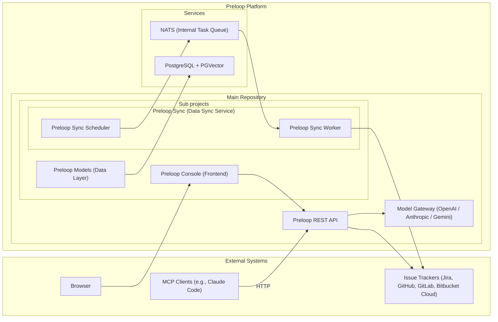

# Preloop Architecture

Preloop is an open-source, responsible AI automation platform. It can proxy tools from MCP servers, optionally adding a human approval layer with configurable policies. It provides event-driven agentic flows to intelligently automate common tasks using the agent harnesses registered in `preloop.agents.factory`: OpenHands, Aider, Codex CLI, Gemini CLI, OpenCode, Pi and DeepSeek Harness. It integrates with issue & code tracking systems like Jira, GitHub, GitLab, Bitbucket Cloud, both for listening to events and for ingesting issues, comments, documentation and code. By leveraging vector-based similarity search, Preloop detects duplicate and overlapping issues, detects unmapped dependencies, evaluates compliance metrics, and offers intelligent suggestions to streamline workflows. The architecture now also includes Preloop-owned model-gateway surfaces so managed runtimes can route model traffic through a central enforcement point for telemetry, budgets, session observability, and secret custody. The architecture emphasizes flexibility, performance, and ease of integration, providing access via a REST API, a web UI, and an MCP server for various clients.

ARCHITECTURE.md is the map. Read one chapter under `docs/architecture/` for the subsystem you are changing. Do not load every chapter for context.

Version-tag publication is gated by [image SBOM and release audit validation](docs/release-sbom-audit.md). Backend, console, scanner and universal images carry inventories for both architectures, bound to immutable image digests and the source commit. The gate waits for the same tag's image and security workflows before publishing release assets.

[MCP dispatch provenance](docs/architecture/mcp-dispatch-provenance.md) defines the
identity-only extension event for completed proxied calls. Optional plugins own
inventory interpretation; hook labels and mutable tool-name maps cannot establish
server identity.

[Account access rules](docs/architecture/account-access-rules.md) includes the portable exact-resource selector and resource requirement contract. Core owns atomic storage, reference validation and generation invalidation; Enterprise owns preview authorization and enforcement of independent local gates.

Live session supervision uses shared Lit state and tool/approval cards across
Talk, Conversation and Transcript. Gateway starts and accounting completions
share a per-request identity; captured OpenAI, Responses and Anthropic tool
metadata has a 64 KiB aggregate bound and follows capture/redaction policy.
Agent detail uses independent identity, session-page and spend reads; Talk uses
bounded delta history and coalesced refreshes. Sidecars stream the open turn's
reply as numbered `session_progress` deltas (merged to four a second, throttled
per session on the server, scoped to the owning account and runtime session);
Talk appends them to a live bubble and re-reads the thread only on a sequence
gap or turn end. Sidecars that send no deltas keep the refresh path. See [frontend read contracts](docs/architecture/frontend.md#route-loading-and-refreshes).
Approval REST queries combine account and runtime-session scope, and websocket
approval payloads pass the same permission boundary before delivery. See
[Runtime sessions](docs/guide/concepts/runtime-sessions.md#following-live-work-and-decisions).

[Employee event intake](docs/guide/virtual-employees.md) authenticates provider events, verifies Flow/account/source scope, reserves the existing delivery-keyed execution before dispatch, and reuses Flow worker claims and recovery. Managed-agent control commands carry encrypted execution credentials; Codex/Nanobot tasks use independent bounded conversations and command-owned interruption.

Implementation PRs can use [durable feedback subscriptions](docs/guide/flows/durable-implementation-feedback.md): PostgreSQL threads and inbox leases coordinate new execution turns, while native conversation artifacts remain isolated from workspace checkpoints. Repository events and bounded reconciliation advance CI/review gates without idle agent containers. Bitbucket review feedback requires a current changes-requested participant state and excludes automated summary comments; metadata updates skip successful reviews of the same pull request head. Feedback opt-in applies to future executions; a preview-and-adopt API binds one older publication explicitly. Live policy changes are checked again at atomic repair reservation. Missing native checkpoints fail closed unless the operator explicitly selected a source-only published-branch handoff. Unreadable repository requirements prevent readiness while fully verified feedback can still authorize bounded repairs.

Forge reconciliation keeps one forge truth for pull request state. Feedback reads split merged from closed (`pr_merged`, `pr_closed`) on GitHub, GitLab and Bitbucket, and a throttled read waits out the provider's `Retry-After` instead of blocking. `services/pull_request_refresh.py` refreshes `IssueCostPullRequest.head_sha`, `state` and `merged_at` for open or not-yet-observed pull requests: at most 25 records and 25 API reads per one-minute tick, including fallback trackers and Bitbucket commit lookups, each open record re-armed after five minutes. Reads use `If-None-Match` when the forge supplies an ETag; Bitbucket Cloud PR reads explicitly fall back to plain GETs without a validator (see [forge reconciliation](docs/guide/forge-reconciliation.md)). A pull request webhook only marks its record due; a merge is never reverted by a later read. Webhook ingress claims each `X-GitHub-Delivery`, `X-Gitlab-Event-UUID` or Bitbucket `X-Request-UUID` in `forge_webhook_delivery` before queueing, answers a redelivery as a duplicate, and releases the claim when publication is not acknowledged. An unpublished claim can be taken over after two minutes; publication and release match the claim timestamp so a late holder cannot mutate its replacement. Copilot records follow the same bounded refresh and ingress dedupe paths.

Delivery Report console reads go through account-scoped CRUD. Attention includes
only pending or unconfirmed proposals, with a fingerprint that changes when the
pending decisions change. Execution detail projects forge state from
`IssueCostPullRequest` and the newest assessment at its current head SHA.
Project reruns use the existing manual flow trigger, narrow the report policy's
scope for that execution, and recheck the policy before running. They preserve
the account's assessment budgets and tracker-write rules.

[Restricted CI administration](docs/guide/flows/restricted-ci.md) is an OSS human-only API, Lit console and CLI over core CRUD. It separates immutable principal/resource ownership from rotating credential lifetime, gates issuance on complete backend contracts, and offers safe expiry/revocation recovery. The OSS owner authority can be narrowed or delegated by EE through current account-local permission hooks; a fresh scalar CRUD permission read avoids cached role authority. No human role can widen the machine's ten-operation route ceiling. Console secrets are ephemeral and CLI secrets go to exclusive private files. The disposable release gate validates real-resource admission/ownership and callback controls; the generic operator workflow verifies persisted exact-head correlation and a separate publication receipt.

Dedicated restricted GitHub App review flows can opt into `publication_mode: read_only`. The principal snapshots that capability; startup reauthorizes ownership and mints only an exact-repository `contents:read` lease. No normal tracker token reaches the clone, no MCP or general REST authority reaches the model, and completion cannot select a writer or publication path. Local result persistence and owned signed callbacks remain available; the separate publisher holds write authority. Legacy and isolated publication retain their existing contracts.

Credential checks use a dedicated synchronous auth pool alongside the sync and
async request pools and the health engine. The auth pool adds its configured
base size to each API/gateway process's retained connection budget, and base
plus overflow to its ceiling. Helm values include this contribution; the pool
monitor reports it as `auth`. Bounded non-machine classification caching never
replaces route authentication; [restricted CI operations](docs/guide/flows/restricted-ci.md#credential-check-resilience)
documents its freshness and database-error fallback windows. Async session
teardown has a single shielded cleanup owner so caller cancellation cannot
interrupt rollback/close or start a concurrent close on the same session.

[Isolated publication](docs/guide/flows/automated-issue-implementation.md#isolated-publication-rollout-and-repair) verifies immutable bundles in fresh credential-free runtimes before acquiring a write lease. Controller-owned evidence reuse binds the execution, bundle, base, profile, pinned image and runtime; sandbox-written evidence cannot populate it. Failed durable repairs retain their latest workspace and native session while recovering only the prior published branch binding from authenticated thread ancestry.
Private-runner log batches use stable delivery identities and acknowledgments so a reconnect can replay unconfirmed output without duplicating stored rows. Socket writes have deadlines, live log broadcasts have a bounded budget, and runner lease release shares the terminal result transaction. Publication and native-session markers are saved while output arrives. The execution console refreshes runner assignment and failure details at lifecycle transitions; an execution without an observed runtime is shown as unassigned.

HTTP model gateways use immutable execution values and fresh worker-owned database
units for authentication, preparation and accounting. Provider waits and stream
pulls retain no Session. See [Gateway database ownership](docs/architecture/gateway.md#gateway-database-ownership)
for protocol boundaries, cancellation and the serialized OAuth rotation exception.

Claude/Codex subscription recovery preserves agent enrollment through
`preloop agents reconnect`. Credential imports serialize with rotation and reject
recently consumed refresh tokens; provider-declared invalid grants require fresh
authorization. See [OAuth credential recovery](docs/architecture/gateway.md#gateway-database-ownership).

The [account kill switch](docs/guide/account-kill-switch.md) serializes halt transitions and runtime admission on the account row. Audit records and durable execution stop intent share the transition transaction. Monitors and recovery workers distinguish a stop request from confirmed runtime termination; approval deadlines recover once by their actual frozen interval.

Database worker ownership, row-lock compatibility, and cancellation rules are
documented in [Transactions and asynchronous request handling](docs/architecture/data-model.md#transactions-and-asynchronous-request-handling).

Agent harnesses receive supported [context and output settings](docs/guide/model-context-limits.md)
from model-row parameters and the vendored catalog. Hosted Codex adds a
version-pinned local catalog for unknown custom models, preserving its generic
instructions and labeling an unknown context as a CLI fallback. The model
gateway controls Codex's upstream output allowance when enabled; direct provider
runs retain provider defaults. Native Codex profiles stay intact. No provider capacity is inferred from an unknown model name.

[Reviewed price feeds](docs/guide/model-price-refresh.md) update the generic model
map and Alibaba's dedicated regional tariff store in each API, gateway, and
worker process. Alibaba estimates retain input tiers and distinct implicit,
explicit, and cache-creation rates. Native discovery keeps credentials on their
documented host; workspace routes can use reviewed regional prices without a
cross-host credential transfer. Weekly review produces a PR with source evidence
and verification gates. Feed ingestion never rewrites historical usage.

Audit collection, the account-scoped query API, and the console are core features
available in every edition. Core owns the audit service, bounded writer and
optional durable outbox; Enterprise uses the same implementation and adds its
RBAC permission checks and events from organizational features.

Audit rows are sealed into a per-account hash chain with signed checkpoints.
Period exports and evidence packs carry detached Ed25519 signatures.
`preloop audit verify` and `preloop evidence verify` recompute both on the
caller's machine. See [Evidence storage and signed records](docs/guide/flows/evidence-storage.md).
The chain proves order and non-deletion in the range it names, not that the
records were true when written; the signing key lives beside the records.

Cloud analytics history is resolved through a billing plugin service at reporting boundaries. Physical retention preserves longer subscription promises through account-locked CRUD updates and remains separate from audit/evidence policy and live governance. See [Cloud analytics history and stored records](docs/guide/flows/evidence-storage.md#cloud-analytics-history-and-stored-records).

Customer-facing gateway reports exclude replay validation and every
`governance_` purpose, including account-funded analysis. Explicit purpose-scoped
budget reads retain analysis spend. Dedicated customer covering indexes preserve
index-only cost and model aggregates; the weekly policy section reports review
cost separately from customer activity.

The Cost console shares one summary between totals, the initially selected
tab and imported usage; settings and later tabs load independently. Exact-window
summary aggregates use a bounded 60-second cache per worker. Selective reporting
queries and per-section loading states are described in
[Progressive reporting](docs/architecture/cost.md#progressive-reporting).
Console catalogue lists use typed `/tools/summary` and `/flows/summary` views
instead of downloading tool schemas and flow prompts/configuration. Full
`/tools` and `/flows` responses retain their existing defaults for editors and
API clients. Flow summary statistics are opt-in (`include_stats=true`) and use
the same period and owned-flow aggregates as the full list, plus each flow's
`last_run` (id, status, times, subject) so the Flows list links the run without
fetching executions. Policies reads `/tools/rules`, each tool's identity and
access rules without descriptions or schemas, and the Tools list asks
`/tools/stats?include_agents=false`, which skips the per-agent breakdown and
its query. Both account gateway
and Cost summaries support selecting repeated `breakdown` sections; callers
needing only totals set `include_breakdown=false`, which skips the unused
aggregations. The grouped audit timeline resolves correlations and approval
lifecycle through account-scoped partial JSON-expression indexes. Their
migration builds indexes concurrently and repairs interrupted invalid builds.
Explicit concurrent-index blocks have bounded lock and statement budgets and
restore the migration session's short blocking-DDL timeout afterwards. Operation
durations and cancellation diagnostics identify contention without extending
the deployment deadline. See [schema migrations](docs/operations/schema-migrations.md).

The [upgrade acceptance harness](docs/operations/upgrade-acceptance.md) runs published
release initializers and Helm hooks against a synthetic corpus in disposable local
stacks. It stops old writers, preserves encryption settings, and verifies data,
identity and credential continuity. Candidate rehearsals remain separate from
acceptance of an actually published release candidate.
Cost and cycle time per tracker issue are rolled up across flows into their own
tables. Each issue row, summary and unassigned bucket also states `cost_coverage`
(`complete`, `partial`, `unknown`) and how many of its runs carry a cost, so an
unpriced subscription-backed run is never read as a free ticket; see
[Cost per issue](docs/architecture/cost.md#cost-and-cycle-time-per-tracker-issue).

Bitbucket Data Center uses the separate `bitbucket_dc` adapter, gated off by
default. Its REST transport enforces administrator-approved HTTPS instances,
context paths, connection-time destination validation and verified TLS; user PATs
use tracker SecretReference encryption through CRUD. Repository numeric IDs
remain stable when slugs change. DC repository/review support targets the 10.2
LTS contract with synthetic fixtures; Jira remains the issue host. OAuth,
webhooks and execution/publication routing are separate integrations. See the
[deployment and validation guide](docs/guide/bitbucket-data-center.md).

API-key scopes are retained in MCP request context: `mcp:read` permits
discovery and resource/prompt reads, while `mcp:write` permits tool invocation.
These checks precede dispatch and preserve the independent account, runtime,
tool-list and policy limits. REST and console channels confine MCP-only keys;
discovery, telemetry and enrollment credentials retain their narrow surfaces.
See [agent credential boundaries](docs/security/agent-isolation.md).

MCP calls with delegated-grant introspection resolve the prefix/first-wins server
through CRUD once and copy its dispatch configuration before releasing the DB.
The exact forwarded bearer/OAuth token is checked with RFC 7662 before access
rules, after approval waits, and after client connection waits. A call keeps the
same owner/configuration throughout; asynchronous approval replay starts a fresh
snapshot and grant check. Inactive grants, missing scopes and unavailable
introspection have separate denial reasons. Only explicit fail-open allows an
unavailable result. Hash-keyed bounded caches limit revocation delay to the
configured TTL (at most 300 seconds); expiry shortens it. Safe grant metadata
flows into policy and tool-call audits, whose account-scoped consent index is
built concurrently. Synthetic simulation does no introspection HTTP. See
[Delegated grants](docs/guide/grant-introspection.md).

Public route and versioning boundaries are defined in
[ADR 0001](docs/architecture/decisions/0001-api-versioning.md) and the
[compatibility policy](docs/compatibility.md#api-versioning): REST uses
`/api/v1`, while OAuth discovery/operations, MCP, and provider gateway
prefixes follow their respective protocol contracts. REST responses, including
errors, carry the diagnostics-only `Preloop-Server-Version` software release
header. The header wraps the complete FastAPI middleware stack so early
rejections and unhandled errors retain it. CLI and console REST URL builders
share a prefix within each client; they do not negotiate versions by header.

Flow routing admission rejects agent-bound subscription models for ordinary
ephemeral execution credentials before creating executions. Matrix admission
validates all cells before writing the batch. Authoritative orchestrator startup
rechecks legacy queued rows before runtime launch and records incompatible
subscription selections as terminal `model_config` failures. Persistent agents, private host
profiles and persistent employee identities keep their existing admission
and gateway ownership checks. See [model routing](docs/guide/flows/model-routing.md#subscription-credentials-and-execution-identity).

## High-Level Architecture

## Chapters

| Chapter | What it covers |
|---|---|
| [Overview](docs/architecture/overview.md) | High-level layout, key components, and the REST search path. Start here for how the API, console, sync, and gateway fit together. |
| [Frontend](docs/architecture/frontend.md) | Console structure (Lit, Vite, TypeScript, Shoelace). Tracker detail, tools page, and cost views. |
| [Model gateway](docs/architecture/gateway.md) | OpenAI-, Anthropic- and Gemini-compatible ingress (`/openai/v1`, `/anthropic/v1`, `/gemini/v1beta`), accounting, budgets, and runtime session identity. |
| [Governance](docs/architecture/governance.md) | Subject-scoped allowed models, tool access rules, and tool output filters. |
| [Account access rules](docs/architecture/account-access-rules.md) | Closed policy syntax, audited CRUD/snapshots, committed H4 invalidation, and H3 resource sharing integration. |
| [Approvals](docs/architecture/approvals.md) | Tool configuration, human-in-the-loop approval workflows, `ask_user`, and native-tool permission-check. |
| [Agent Control](docs/architecture/agent-control.md) | Operator channel to managed agents, operator notes delivered at model/tool boundaries through the gateway, carrying permission hooks, or native lifecycle/model-input hooks; non-carrying approval hooks leave notes pending, CLI/desktop enrollment, mobile/watch voice contact, and persistent flow execution on a live Agent Control target. |
| [Cost](docs/architecture/cost.md) | `ApiUsage` ledger, OSS spend and budget-health surfaces, and the Enterprise plugin boundary. |
| [Sync](docs/architecture/sync.md) | Tracker polling, NATS scheduler/worker, issue tracker clients, and tracker scope rules. |
| [Data model](docs/architecture/data-model.md) | `preloop.models`, PostgreSQL + PGVector, schema, and backend project layout. |
| [MCP](docs/architecture/mcp.md) | FastMCP integration, dynamic tool filtering, and the HTTP MCP request path. |
| [MCP protocol compatibility](docs/architecture/mcp-protocol-compatibility.md) | SDK 2 / FastMCP 4 APIs, modern and legacy transport matrix, validation and no-replay boundary. |
| [Realtime](docs/architecture/realtime.md) | Unified WebSocket, MessageRouter topics, and account-scoped pub/sub. |
| [Security](docs/architecture/security.md) | Auth and tenancy, restricted CI machine identities, owned review execution admission, principal-bound completion callbacks and default-deny HTTP boundary, per-user JWT `auth_generation` / revoke-all, redaction, secret custody, audit hash chain, record signing, security-screen scoring, and `preloop.security`. |
| [Decisions](docs/architecture/decisions.md) | Why FastAPI, Python, and PostgreSQL, and how the stack is deployed (Compose, Helm, service roles). |
| [Flows](docs/architecture/flows.md) | Event-driven agentic flows, remote runners, matrix/batch fan-out, delegation and execution trees, label-based model routing, eval artifacts, evidence packs, prompt `truncate(N)`, and the chunked agent launch-payload environment. |

Execution environment profiles and hosted checkpoint recovery are documented in
[Environments and recovery](docs/guide/flows/environments-and-recovery.md).
What enforces browser network access for a flow agent is
[Browser access](docs/guide/flows/browser-access.md).
Workspace checkpoint capture streams individual files and enforces its
compressed size cap during packing. Dependency directories and caches are
excluded; oversized captures leave the last complete checkpoint available.
Hosted legacy GitHub App publication refreshes repository-scoped credentials on
the controller immediately before push or PR creation. A signed runner capability
binds the execution, account, tracker and startup repository; issuance requires an
active execution. App signing keys remain on the controller. The runtime replaces
stale git credentials and uses the fresh token for PR REST calls as well.
The sandboxed-browser allowlist sidecar lives in
[`environments/egress-proxy`](environments/egress-proxy/README.md).
Hosted Codex defaults to the digest-pinned universal image
(`ghcr.io/preloop/preloop-codex-universal`), which includes the distro Perl
toolchain. Private runners can still build
[`environments/perl`](environments/perl/README.md) and select it with
`agent_config.image`. Native host profiles use no image. Hosted Codex uses the
Responses API; chat-only custom models must enable `meta_data.gateway.enabled`
to use the gateway translation. Flow saves reject incompatible bindings with
remediation, and legacy incompatible runs fail with `model_config` before launch.
Direct providers explicitly configured for Responses remain supported.
Codex uses JSON events: only the last assistant message in a completed turn
can provide a plaintext completion marker. Prompt echoes, tool output and
diagnostics stay escaped in the log. The completion grace timeout captures
artifacts and stops the runtime before reporting terminal success.

Native Copilot host profiles can publish through managed legacy publication
(`backend/preloop/services/host_exec_publication.py`, runner
`cli/internal/cmd/runner_host_exec_publish.go`). The flow must clone exactly one
repository with `create_pull_request` in legacy mode, and the runner profile must
set `allow_checkout` and `allow_publish`, which makes the runner advertise
`host_publication`. Flow save and run start refuse the flow when no runner in the
pool advertises it, and lease assignment skips runners that do not. Delivery adds
a transient `host_exec_publication` plan (checkout path, managed
`preloop/issue-<KEY>-<exec8>` branch from the shared branch-plan resolver, commit
message); the push reuses the checkout's URL-scoped header credential and nothing
is persisted. After the CLI succeeds the runner commits with hooks disabled,
copies the head into a fresh runner-owned bare repository and pushes from there
without force, with no repository, global or system git config, to the planned
URL, and reports a `host_publication` receipt
on the completion envelope. The completion path keeps only that runner receipt
(agent JSON cannot author it) and fails a publishing run without a pushed branch.
The orchestrator verifies the branch against its own plan, looks up an open pull
request for it before creating one through the bound Bitbucket tracker, and
binds it with `record_opened_pr`, so a lost create response never yields a second
pull request.
A succeeded publishing run stores its validated Copilot session (with profile
and model alias) on `cli_session`. Feedback on that pull request reaches the host
flow through the existing feedback thread `_resume`; the orchestrator validates it
with `resolve_host_continuation` (`services/host_exec_continuation.py`): same
flow, same profile and model alias, a confirmed pull request on the resume
branch, and an originating runner that advertises `host_continuation`. Anything
else fails `resume_unavailable` instead of starting a fresh implementation. The
lease carries a control-plane `host_exec_resume`, is pinned to the originating
runner, and the runner adds `--resume=<session>` itself, checks the session is on
the host, and pushes onto the existing pull request branch. A completion naming a
different session fails `resume_identity_mismatch`.

Private runner leases enforce `flow_execution_consent` before creating any assignment. `ask_me` (the default) binds a durable `OwnerConsent` to the execution and selected runner, with a standard approval addressed only to the runner owner. Retries keep the same owner; pending execution waits until the existing approval window expires. `always` permits assignment and `never` rejects it. Owner settings survive reconnects unless registration explicitly changes them. Shared-runner consent belongs to the resource account, while execution-account lookups retain the selected runner across retries. Owner-less runners requiring consent are skipped so routing can use another eligible runner or hosted compute.

Managed agents default `others_may_start_sessions` to `ask_me`. Agent Control checks new-session intents before dispatch, while commands for existing sessions keep their existing behavior. An approved request is consumed once, scoped to its requester and exact intent. Owner consent uses the existing notification preferences and mobile push, and does not inherit tool approval bypasses or administrator decision exemptions. Notification delivery uses a short delivery lease to prevent concurrent workers from sending the same pending request; abandoned leases expire, and failed delivery releases the claim. Persistent flows also queue owner consent before starting a new agent session; automated triggers do not infer a human owner exemption. An executor recovered without its temporary launch credentials fails closed and asks for a flow restart rather than persisting credentials. Authorized nonowners starting a fresh runner-hosted harness session need the same single-use owner approval before checkout credentials are minted.

A personal runner can also host remote harness sessions (#1482): the server
writes start, turn and stop requests to `runner_remote_sessions`
(`services/runner_sessions.py`) and delivers them over the runner websocket on
the next heartbeat or at once from the replica holding the socket; the runner
(`cli/internal/cmd/runner_sessions.go`) runs Copilot CLI one process per turn
with `--session-id` then `--resume`, only for harnesses the host user enabled
with `preloop runner sessions enable`. Each session pairs with a
`RuntimeSession` of source type `runner_session`, which
`resolve_session_control_mode` puts in command mode. Hook calls that carry the
runner-reported `harness_session_id` resolve to that runtime session while it is
live (`agent_session_lineage.runner_session_for_external`); a session a hook
opened before the id arrived is folded into it. See
[Remote sessions](docs/guide/runners/remote-sessions.md).

Operator-note receipts distinguish a deferred claim from delivery at a supported
model or hook boundary. Native session-end signals settle pending and claimed
notes targeted at that session. The minute runner sweeper also reconciles notes
against authoritatively ended `RuntimeSession` rows in bounded batches, with
guarded transitions and once-only audit/webhook emission. It does not infer
termination from inactivity alone, and standing agent-targeted notes remain
available for a later session. The [operator-note guide](docs/guide/operator-notes.md)
lists harness capabilities; the [verification guide](docs/guide/operator-notes-smoke.md)
provides isolated receipt and lifecycle checks.

Runner registration and heartbeats report `docker_available` from a five-second `docker ps` probe. Container leases require that capability, including explicitly pinned runners. The CRUD layer excludes paused runners from selection and slot claims; leasing rechecks scheduling preferences after locking the row. Capability tags are derived from the current daemon result and enabled, signed-in harness inventory alongside custom labels. `accept_untagged` defaults to false and `paused` defaults to false; console scheduling edits persist independently of the process's registration and heartbeat. Automatic routing uses hosted compute when no private runner accepts the job.

Cursor remote sessions require host consent and the Preloop approval hooks. The host creates a chat with `cursor-agent create-chat` and uses `--resume` for each turn, with the same authorized workspace policy and process cancellation as Copilot sessions.

Remote sessions on a personal runner (`docs/guide/runners/remote-sessions.md`)
use a workspace policy that keeps paths on the host: the operator lists
directories with `preloop runner dirs add` (stored in `~/.preloop/runner.json`,
advertised as id, label, mode and harness list with register and heartbeat),
and the runner (`cli/internal/cmd/runner_workspace_policy.go`) re-validates
the entry and proves a requested path stays inside it after realpath
resolution (case-folded on Windows, reparse points treated as symlinks, root
and home refused) before a session opens it; a git work tree with uncommitted
changes is refused unless the owner allows it. A tracker checkout clones into
`host-workspaces/sessions/<id>` with a credential minted per start by
`backend/preloop/services/runner_workspace_credentials.py` (a GitHub App
installation token scoped to one repository with `contents: read`, or the
managed Bitbucket Cloud OAuth token; PAT, app password and access-token
trackers are refused by name), delivered only in the start message, served
to git through an askpass helper over an inherited pipe, never written to
disk, `.git/config` or a log, stripped from persisted payloads, and the
directory is deleted when the session ends.

A flow with an enabled `git_clone_config.backport` block runs in a
control-plane mode: the orchestrator cherry-picks the merge commit onto each
target branch in a scratch repository and opens one pull request per target,
with no agent container. See
[Release backport](docs/guide/flows/release-backport.md).

### Flow delegation and execution trees

A flow execution can start another flow of the same account as a child of
itself through the default-off `run_flow` tool, gated by both the flow's
`allowed_mcp_tools` and its `callable_flows` allowlist. `FlowExecution` carries
`parent_execution_id`, `root_execution_id` and `delegation_depth`, so a subtree
is one query and rows that predate the columns read back as roots.
`GET /api/v1/flows/executions/{id}/tree` returns an execution, its descendants
and a rollup in the same shape the batch listing uses. `run_flow(wait=true)`
waits in process briefly and then parks the parent on `WAITING_FOR_CHILDREN`,
releasing the container, the runner and the runtime token exactly as a park on
a human decision does; the parent resumes as a new execution that natively
continues the same agent session. Depth, fan-out and subtree cost are bounded
by `FLOW_DELEGATION_MAX_DEPTH`, `FLOW_DELEGATION_MAX_CHILDREN` and
`FLOW_DELEGATION_MAX_TREE_USD`. See
[Flow delegation](docs/guide/flows/flow-delegation.md).

### Agent note governance

`send_note` resolves its target and validates the hook's caller session against
its credential principal before evaluating standard tool access rules. Seeded,
editable rules allow self and descendants, request human approval for other runs
the sender's owner can control, and deny the rest. Scope facts are recorded with
the approval; async polling executes the approved call against its resolved
target. Request tokens authorize decisions by the bound human, while automatic
approval bypasses leave these requests pending for that human. Pending note
approvals have a separate per-sender/target cap, checked under the account's
approval admission lock. Startup seeds unconfigured accounts independently,
preserving progress and logging each failure for a later retry.
`preloop spawn` passes the registered conductor session and worker alias to
child processes and drops the conductor's harness identity variables. See
[Spawning workers](docs/guide/spawning-workers.md).

### Telemetry export

Optional OpenTelemetry export (`preloop.services.otel_export`, disabled by
default) emits GenAI spans for governed model calls and MCP tool calls to any
OTLP endpoint, carrying `gen_ai.conversation.id` when a runtime session id is
present. Token and cost attributes match the `ApiUsage` row for that request;
prompts, completions and tool arguments are not attached. Exporter errors are
logged and never fail the user-facing call. It supplements the `ApiUsage`
ledger rather than replacing it. See [OTLP export](docs/guide/observability-otlp.md).

### Telemetry ingest

The opposite direction: `POST /api/v1/telemetry/otlp/v1/{metrics,logs,traces}`
(`preloop.api.endpoints.telemetry_otlp`, `preloop.services.otlp_telemetry`)
receives Claude Code, Claude Desktop and Cowork OTLP/HTTP exports, directly
or relayed by a Claude apps gateway's `telemetry.forward_to`. A key scoped
only to `telemetry:ingest` reaches nothing else. An allowlist keeps
`api_request`/`api_error` events and the cost, token and session metrics
and drops everything that could carry prompts, commands or paths. Events
enrich the matching gateway usage row (by `x-client-request-id`) or create
one `telemetry_estimate` row, which a later gateway row for the same request
replaces in its own transaction; metrics build hourly aggregates only for
sessions with no log events and no gateway rows. Dedup keys in
`telemetry_ingest_dedup` make exporter retries no-ops. See
[Claude client telemetry ingest](docs/guide/clients/claude-telemetry-ingest.md).

### Agent launch payload (custom images and runners)

Linux caps one `execve` string (a single argv element or a single
`NAME=value` environment entry) at `MAX_ARG_STRLEN`, 131072 bytes. The
control plane therefore does not put an unbounded prompt or Kubernetes
inner script in one string.

The rendered prompt travels as `PRELOOP_AGENT_PROMPT_0..N` (plus
`PRELOOP_AGENT_PROMPT_CHUNKS` and `PRELOOP_AGENT_PROMPT_BYTES`), is
reassembled into `/tmp/preloop/prompt.txt`, and is advertised as
`AGENT_PROMPT_FILE`. `AGENT_PROMPT` is set only when the prompt is 64 KiB
or less. The Kubernetes inner script uses the same pattern:
`PRELOOP_INNER_SCRIPT_0..N` into `/tmp/preloop/agent-script.sh`, with a
legacy whole-value `PRELOOP_INNER_SCRIPT` still honoured so old and new
images interoperate.

Custom images and private runners should read `AGENT_PROMPT_FILE` (or
reassemble the chunks) and must not require `AGENT_PROMPT` for large
prompts. The full contract is in
[Agent launch payload (container environment)](docs/architecture/flows.md#agent-launch-payload-container-environment).
Private Docker launch shape is in the
[runner image contract](docs/guide/runners/quickstart-linux.md#what-the-runner-executes).

### Issue lifecycle controller

`services/issue_lifecycle.py` coordinates structured readiness, one authorized
implementation pickup, and independent merge/deployment acceptance audits.
`IssueLifecycle` records live scope revisions, immutable merge references,
execution bindings, evidence and follow-up identities through the CRUD layer.
Transaction locks serialize each tenant/issue; provider markers recover external
writes after local rollback. The trigger service prepares lifecycle executions
before ordinary dispatch, and the orchestrator consumes durable structured output
at completion. The GitHub adapter revalidates closing-commit/merged-PR authority;
manual completion alone does not start an audit. Readiness consumes approved
execution-environment capabilities rather than implementing test setup. See
[Issue readiness and completion audits](docs/guide/flows/issue-lifecycle.md) for
policy, API and recovery configuration.

`services/issue_triage_controller.py` reuses this ledger for durable issue-revision
claims across manual and automatic triage. Dedicated advisory-lock connections
serialize local applies while provider-write intents commit durably. Execution
credentials bind managed writes to their issue/revision; successful bounded
assessment packets retain input/output revision and policy/context identity.
Readiness consumes only applicable server-loaded packets as evidence, preserving
its separate implementation authorization. Provider writes remain optimistic;
local serialization cannot make external APIs support compare-and-swap. See
[Issue triage](docs/guide/flows/issue-triage.md) for recovery and tool boundaries.

### Security maintenance controller

`services/security_maintenance.py` coordinates opt-in supported-release
inventory, one work item per product/release/advisory/component, and
fail-closed completion. Inventory is API-configured. Implementation uses the
existing flow dispatcher and isolated publication receipts (`head_sha`).
After approval, a rebuilt SBOM must be submitted for the published commit;
recheck does not reuse the original inventory. Removal is derived from
identities in those submitted bytes, not from model inventory omission.
Initial baseline acceptance requires the controller envelope `release_id` and
the digest of the supplied SBOM. Tests and baselines require
controller-owned verification and the contracts CRA validator; caller-supplied
evidence ids and agent `finding_absent` fields do not grant. Platform
`ApprovalRequest` rows carry human decisions. Dispatch claims expire so a
crash between claim and enqueue cannot strand a still-`PENDING` execution.
Audit/recheck completion observes frozen Git bundles from evidence when the
flow names repository URLs and the pin is an exact git SHA; `HEAD.txt` is
not checkout proof.
See [Supported-release vulnerability maintenance](docs/guide/flows/security-maintenance.md).

Session search writes one `session_search_document` chunk per source row
(gateway interaction, transcript, tool call, operator note, summary). Keyword
indexing is gated by `SESSION_SEARCH_INDEX_ENABLED`. Optional vectors are a
separate per-account opt-in (`session_embedding_setting`, `summaries_only` by
default so an opt-in embeds the session's title and summary chunk unless the
account asks for `full`) plus the
deployment kill switch `SESSION_EMBEDDING_ENABLED`; a bounded worker posts
batches to an OpenAI-compatible endpoint or a local model, caps spend, and
records purpose-tagged usage. The shared API key is allow-listed.
`POST /api/v1/runtime-sessions/search` reads it in `keyword`, `semantic` or
`hybrid` mode, fusing the two candidate lists by rank; a half that cannot run
is reported in a degraded block with keyword results, never as an error.
`GET /api/v1/runtime-sessions/{id}/similar` reads the same vectors with no
query at all: a session is compared by a stride sample of its own chunks, in
its own model's space, and spends nothing.
See [Similar sessions](docs/architecture/similar-sessions.md).
A question worth repeating can be saved under a name in `session_saved_search`
and re-run from `/runtime-sessions/search/saved`; a saved search stores the
question and never the answer, is private until its author shares it with the
account, and a run says which of its filters no longer resolve.
Personal saved-search writes use `view_runtime_sessions`; creating or changing
a search to account visibility also requires `share_session_searches`.
Optimization submissions require `run_session_optimizations`, while replay
requires `edit_ai_models`. The sharing and analysis permissions are granted to
owner, admin, editor and executor by the system-role initializer and an Alembic
data migration for existing databases.
The same ranked search is reachable as the built-in `search_sessions` tool
(default off, own-sessions scope unless an operator grants `account`) and from
`preloop sessions search`. Every content search writes one audit row through
the ordinary audit path, with the mode, the filters, the result count and a
stable hash of the query; the query text itself is stored only when the account
opts in.
Operator knobs: [Session search](docs/operations/session-search.md) (coverage,
the history backfill, who may search) and
[Session embedding](docs/operations/session-embedding.md) (the vector worker).
Saved searches: [Saved session searches](docs/guide/session-saved-searches.md).
Search auditing: [Auditing session content search](docs/guide/session-search-audit.md).
The agent-facing tool: [search_sessions](docs/guide/agent-session-search.md).

Audit collection also offers a durable delivery path behind the default-off
`PRELOOP_AUDIT_OUTBOX_ENABLED` flag. Committed sanitized intents are relayed into
audit rows transactionally; failed deliveries back off and park after a finite
retry budget. Approval transitions, policy evaluation, MCP activity outcomes and
model-content policy hits enqueue in their owning database transactions, bypassing
bounded audit admission. Async callers await only local database work; the relay
owns its sessions on a separate thread. Due lag, failed attempts and parked rows
have opt-in Helm alert rules; drop alerts remain for best-effort callers. Local operators can preview and replay a bounded failed batch for
one account with `python -m preloop.services.audit.replay`. See
[Audit outbox operations](docs/operations/audit-outbox.md) for activation,
admission limits, metrics and recovery.

### Pi and DeepSeek Harness adapters

The `pi` and `deepseek` kinds share `ExtensionHarnessAgent` for hosted and private
Docker launches. `runtime-plugins/harness-preloop` supplies Pi extensions and
DeepSeek Cordis plugins for MCP, fail-closed native approvals, lifecycle ingest,
and authenticated active-session control. CLI enrollment owns a separate
`preloop.json`, preserving native configuration, and registers only its own
loader or marked patch nodes. DeepSeek's released headless startup is replaced
with a stdin provider to keep prompts outside argv. Execution-scoped credentials
can request native approvals only for their own active flow session. See the
[adapter guide](runtime-plugins/harness-preloop/README.md) for version pins,
capability limits, and publication order.

### Remote agent deployment

The optional agent-deployment API authorizes account owners and administrators,
then runs CLI installation and live onboarding through a host-key-pinned SSH
connection. The GCP adapter creates a uniquely named VM without cloud identity,
reads its host key through the authenticated Compute API, and removes resources
on failure. Before returning success, the API checks the account's registered
agent and selected model binding through CRUD. Credentials stay in request
memory; audit events contain deployment identifiers and outcomes. See
[operator configuration](docs/operations/agent-deployment.md).

Cost digest consumers use full-window CRUD aggregates for model and agent
request rankings. SQL window totals preserve unknown activity and remaining
known groups while returning at most three named entries plus a bucket row.
Agent attribution prefers the account-owned direct managed principal, then
an account-owned session's managed agent, then a named principal. Account
constraints and scalar session association prevent cross-account labels and
join fan-out. Console exact-period links preserve UTC microseconds and use
normal authenticated account scoping; URL account context grants no access.

Console agent spend (Agents list, Agent detail, the Overview Inventory and the
user page, the last two via the opt-in `breakdown=agents` section of
`GET /api/v1/account/gateway-usage/summary`, which returns `usage_by_agent`
for the whole account and is empty when `runtime_principal_id` is set) reads
one CRUD aggregate. A
gateway row belongs to an agent when its runtime principal is the agent's base
source id, or when it ran in a session the agent owns: the bound session, a
session whose runtime principal is `managed_agent:<id>`, or a per-run session
whose source or principal id is `<base>:<run>` or `<base>-<run>` (longest base
wins). A row whose principal names another agent's base id stays with that
agent, so no row counts twice. Only the window differs between surfaces (all
time, the detail range, the Overview range). Subscription-routed rows
(`cost_source='subscription'`) count in an agent's requests and tokens and add
$0 to its spend; each surface also reports the agent's subscription block
(the Cost page's `SubscriptionUsageSummary`: requests, tokens, the summed
`meta_data.api_equivalent_cost` estimate and its coverage) and shows "without
subscriptions" as spend plus that estimate, a lower bound when coverage is
partial and no figure when nothing is covered.

The Agents list reads all-time figures from `agent_usage_total`, grouped by
account, source principal and runtime session. PostgreSQL triggers apply
transactional deltas on usage insert, update and delete, so corrections and
rollbacks affect requests, tokens, metered cost and subscription pricing
together. Statement triggers group transition rows by scope before updating
counters, so bulk imports, repricing and deletes do not rewrite a shared counter
once per request. Monetary counters use decimal arithmetic. Agent ownership is resolved
at read time from these source dimensions, so reassigning a session does not
require rewriting historical usage or counters. Date-window detail and Overview
readers retain their existing source aggregates.

The migration installs capture before an online backfill. `agent_usage_counted`
records which source IDs contributed; bounded batches lock source rows and claim
IDs once, making retries and concurrent writes safe. `agent_usage_backfill`
persists progress and enables stored reads only after completion. During an
incomplete backfill the list uses its metered-cost fallback and reports
`subscription_usage_computed=false`. Once ready, the without-subscriptions
estimate appears in a separate column immediately after metered estimated spend.

Managed tracker OAuth persistence uses the [provider-neutral storage contract](docs/architecture/managed-oauth-storage.md),
with tenant-bound connection transactions and serialized token-pair rotation.
The console creates a managed tracker at consent completion, before scope is
saved. Subsequent Bitbucket repository and Jira project discovery carries that
tracker's id so the backend can recover its server-held grant even when the
browser has no token. Bitbucket repository choices load for the selected
workspace; changing workspaces clears stale choices and failures require an
explicit retry. Managed detail headers use the grant state rather than the
tracker's historical validation flag.
Consumption is the resolver contract in `preloop.services.managed_credentials`:
a tracker with `auth_type == "managed_oauth"` stores no token, and every
caller (tracker factory and scanner clients, `api.common.get_tracker_client`
behind MCP and REST, connection/scope testing, feedback reads, flow clone
credentials, and the execution-bound publication credential endpoint) asks the
plugin service `managed_oauth_resolver:<provider>` for a fresh credential
right before network I/O, after the usual account/project authorization. The
Bitbucket Cloud client pins the API origin, follows at most three validated GET
redirects within the HTTPS API namespace (including canonical diff/diffstat
commit-range URLs), refuses write or unsafe redirects, and forces exactly
one refresh on a 401 and has no Basic or stale-key fallback; typed
unavailable/reconnect-required/permission failures propagate instead of an
anonymous clone or a GitHub fallback. Late publication reuses the GitHub App
refresh wrapper: the runner's execution-bound capability is exchanged for the
current access token plus its git username (`x-token-auth`) only while the
execution is running and the destination lies inside the tracker's workspace
binding; refresh tokens and consumer secrets never enter containers.

Managed Jira connections sharing one Atlassian user may share its required
callback URL. Registration retries that URL only after validating the configured
HTTPS origin and persisted ownership under the same Jira cloud and OAuth user.
Signed deliveries route by exact stored callback URL and returned webhook IDs,
with active grants, current project scope, and subscriptions checked for each
receiving tracker. Verified cloud/user namespace metadata is retained on webhook
rows and backfilled on a successful refresh, so disconnecting the original
connection does not revoke another active connection's registered delivery.
Legacy rows require a live anchor grant until that reconciliation. They never
fan out by site alone. Registration failures count
as scanner errors even when issue synchronization succeeds. Managed repository
URL lookup permits an empty stored key; credentials still arrive through the
orchestrator's managed resolver.

### Nanobot managed runtime

The optional `runtime-plugins/nanobot-preloop` process embeds a pinned Nanobot
Python SDK and reuses Agent Control, runtime enrollment, the model gateway and
MCP firewall. It owns persisted session references and bounds turns, duration and
token/context consumption. Native and MCP tool execution require explicit
Preloop permission decisions; background subagents and outbound channel tools
are disabled. See its README for supported limits and installation.

### Authenticated chat operations

Chat connections authenticate provider ingress before persisting a tenant-owned
receipt. Expiring single-use proofs bind provider users to Preloop users. The
separate chat worker consumes a leased PostgreSQL ingress/outbox, delegates a
fixed read-tool registry and explicit human commands to existing authorized APIs,
and routes the account default model through the existing gateway. Protected
replies revalidate actor, permissions, resource access, and scoped read snapshots
before private provider delivery. Ambiguous writes become observable uncertain
work rather than automatic duplicate operations. Helm installs can enable the
separate Deployment with `chatWorker.enabled`; it shares API credentials and
operator network/CA settings, while provider health remains connection-specific. See
[Chat connections](docs/chat-connections.md) for setup and operational limits.

The public `/api/v1/features` payload reports an explicit `oss`, `cloud`, or
`enterprise` edition and the running backend `server_version`. Hosted instances
are Cloud; self-hosted proprietary installations are Enterprise; other installs
are OSS. Runtime deployment detection wins over static plugin declarations; plugin counts
never determine the edition.
Feature flags remain the authority for individual capability gates. The console
reuses its cached features payload for the header help menu; documentation,
release notes, and issue/support destinations come from brand URL configuration.

Provider inference-hook setup and health use an OSS Lit lazy view gated by
`anthropic_inference_hooks` and the existing `manage_policies` permission.
Commercial plugins own tenant authorization, encrypted secret custody and
callback evaluation. The console accepts write-only secrets, clears them after
submission/disconnection, and preserves unverified coverage and pending pilot
states even when callbacks are observed. It creates no grants or policy DSL.

The weekly governance review's policy document, version history and review
settings render as a "Governance policy" tab on the Policies page, an OSS Lit
component gated by the `governance_review` capability. `view_policies` reads,
`manage_policies` edits; the extension plugin owns storage and rule compilation.

### Hosted model visibility and request billing attribution

The console loads entitled hosted models and durable allowance balances through
the capability-gated `/account/hosted-models` API. Models, Cost, and Plan share
the allowance display, including outstanding holds and the monthly reset date;
one-time credit has no reset. Subscription details live on Plan, while Account
links to that view. Gateway events preserve the billing path and actual resolved
model row captured at request time, so later alias changes cannot relabel history.

Prepaid credit is a separate ledger (`hosted_credit_account`,
`hosted_credit_ledger`, `hosted_credit_purchase`) with one lot per purchase.
The allowance balance above is unchanged: `reserve` and `settle` do not spend
credit yet. An absent `hosted_credit_topup_setting` row means auto top-up is off.

`preloop models list` separates your models from Preloop-hosted models and reports
the allowance when supported. Before adding a system alias, operators can run
`preloop models check-hosted-alias ALIAS` for aggregate collision warnings.
The lookup exposes no account identifiers and does not change model routing.

### Cache-inclusive input tokens

`ApiUsage.prompt_tokens` is cache inclusive for every provider: it counts the
input read from and written to the prompt cache as well as the uncached part,
so `uncached = prompt - cache_read - cache_creation` holds per row and in every
aggregate. Anthropic reports `input_tokens` without the cache, so the gateway
adds `cache_read_input_tokens` and `cache_creation_input_tokens` back when it
records a raw Anthropic payload (`usage_token_details.anthropic_cache_input_tokens`);
litellm's OpenAI-shaped usage is already inclusive and is left alone. The raw
provider usage stays in `meta_data.usage_details`, and cost is priced from it,
so cached input keeps the cache rate. The remaining clamp at zero only absorbs
provider rounding.

Existing rows were backfilled rather than guarded at read time
(`20261106_anthropic_cache_input`): aggregates sum `prompt_tokens` from
covering indexes that never read `meta_data`, so a read-time guard could only
be a heuristic over sums, which a mix of Anthropic and other traffic defeats.
The backfill touches only rows whose raw usage is the Anthropic shape and whose
`prompt_tokens` still equals the raw `input_tokens`, and records what it added
in `meta_data.input_cache_backfill` for an exact downgrade. Because the
migration runs before the new pods while the previous release keeps serving,
each API replica runs the same conversion once more over the last day of rows
15 minutes after startup (`services/anthropic_cache_input_repair.py`); an
advisory lock lets one pass run at a time and the update re-checks each row,
so concurrent replicas never convert a row twice.
`estimated_cost` is not repriced: catalog-priced rows were already priced from
the raw usage, while rows priced by a configured price or the DeepSeek native
tariff keep the old undercount of their uncached input. Activity rollup
buckets and budget windows written before the change keep their original
token counts.

### Console edit permissions

Edit controls use the cached user profile with three distinct states: a null
permission list preserves OSS behavior, an RBAC list grants only named actions,
and an unresolved or failed profile disables edits. Budget components also accept
`readOnly` to display limits without add/edit/delete actions. Models use separate
create/edit/delete grants; user actions use `manage_users`, invitations use
`invite_users`, and team actions mirror the endpoint's create/edit/delete/manage
permissions. Backend authorization remains the enforcement boundary.

### Console list defaults

At 1440x900, the default content of the five remaining list pages in #1585
fits within three viewports. Audit requests 25 events per page, retaining
explicit URL and saved size choices. Tools shows ten tool rows or collapsed/empty server
headers per page across MCP and native groups. New Flow shows five catalog
presets and ten searchable allowed tools per page, preserving selections
across pages. Its allowed-tool section starts closed. Gateway session usage,
provider headroom snapshots, and the Plan feature comparison open on request;
the Gateway and Plan disclosures remember the reader's choice.

### Console list filter URLs

Sessions, Audit, Approvals, and Tools apply filter changes as they are committed;
text searches debounce typing. Filters use `replaceState` while preserving
unrelated deep-link parameters and the URL hash. Sessions stores `source_type`,
`status`, `has_artifacts`, `range`, `from`, and `to` beside its existing search
and session selection fields. Audit repeats `event_type`/`outcome` for multiple
values and stores tool/date/cost fields under their API names. Approvals stores
`status`, `tool`, and `q`, retaining its latest-100 browser filtering model.
Date strings from shared links are validated before timestamp conversion.

Tools stores independent MCP filters as repeated `mcp_status`, `mcp_server`,
`mcp_rule`, `mcp_workflow` plus `mcp_q`, and native filters as `native_agent`,
`native_rule`, `native_q`. The `tab` parameter selects the visible tab without
discarding either filter set. Successful initial loads, including empty catalogs,
retain mounted content during subsequent background refreshes.

### Policy draft simulation

`POST /api/v1/policies/evaluate` accepts one sample tool call and a stored
policy, unsaved tool rule, or draft YAML. It uses the firewall's shared rule
evaluator with recording disabled and reports the ordered checks, winning
rule, overlapping rules and condition errors. Model text is an optional separate
sample; model I/O and sensitive-data evaluators also disable their audit and
notification hooks. Simulation does not dispatch tools, create approvals or
record usage. The console's `policy_simulation` capability exposes draft testing
in the rule dialog and YAML editor. Paths are evaluated as submitted, without
normalization, so operators can test traversal and repeated-slash samples.

Console monetary values use the shared USD formatter, with exact precision in tooltips; non-USD provider invoices retain their denomination through shared currency helpers. Server timestamps use the UTC-aware date utilities. Wide tables use the shared `table-scroll` stylesheet in both document CSS and Lit shadow roots so content scrolls within its container at phone widths. Full list-controller migration remains incremental.

Model-price override edits and provider-price fetches require `edit_ai_models`; repricing and budget controls require `manage_budgets`. User role assignment requires `assign_roles`, independently of user management. Console capability copy is based on plan availability, separately from viewer permissions.

### Console accessibility

Console metadata uses the shared `--console-meta-color` token, whose contrast
against the console surfaces is tested in both themes. The frontend test command
checks source text colors and programmatic names on native and Shoelace controls.
Placeholder text alone does not name an input.

The console sidebar uses native navigation lists, links with `aria-current`, and
expandable `details` groups. After a successful route change, the shell focuses
the new view heading and announces its title; initial page load does not move
focus. The shared `ConsoleStatus` controller supplies hidden polite status regions
for asynchronous authenticated views, and the approvals view announces new live
requests without moving keyboard focus. Empty capability-gated views stay silent.

Resource detail headers use the shared `resource-access-panel` for compact Access
and Tags controls. Sharing requires the server's `resource_sharing` capability
and a supported model, MCP server, or managed-agent kind; hierarchy alone never
advertises sharing. Flows, policy baselines, and runner pools retain independent
`abac_rules` tag controls. Editors use persisted drafts with explicit Save/Cancel,
an anchored desktop popover in the browser top layer, and a phone dialog. Model
metadata controls mount only after ownership is known; global provider models
without an account do not expose unsupported Access or Tags endpoints. Account defaults describe policy
configuration, and sharing summaries describe intent rather than effective access.
Sharing targets reference existing sharing permits. The independent
`resource_access` capability adds People & teams, applied-rule provenance and
conditional explanations on supported resources, including accounts without
subaccounts. Local action gates and their designated UUID-targeted permits use
server preview tokens and document versions before Save; drafts survive conflicts
and rebase only on an explicit reload. Sharing saves remain a separate operation.
The shared visual rule form preserves advanced selectors/conditions as complete
YAML and keeps inherited rules read-only. The account-wide builder uses per-rule
versions and distinguishes additive permits from restrictive gates; account-mode
changes use their separate policy-only preview API. Explanations identify RBAC
and runtime ceilings rather than promising final effective access.

The optional ticket-readiness observer uses account-scoped immutable policy and gate-evidence records, historical first-ready series, durable per-PR leases and round-robin reconciliation. Its credentialed fetch and offline object-only Git probe run in separate constrained containers. Reporting labels configured-policy coverage explicitly and preserves existing cycle-time intervals; see [sampled ticket readiness](docs/guide/ticket-readiness.md).

### Discovery source observations

Optional versioned evidence extends the existing discovery report via the named
`discovery_evidence` plugin service. Generic immutable observation storage and
tenant-scoped CRUD live in `preloop.models`; commercial correlation/read policy
lives in the optional plugin. Candidate deduplication and discovered events
remain unchanged. Collector assertions preserve provenance and scan gaps, and
do not establish runtime verification or device attestation.

Expected-device inventory uses the shared `ExpectedDevice` model and
`crud_expected_device` persistence boundary. An account-local roster is separate
from reported discovery candidates, immutable source observations and device
credentials. Atomic roster replacement serializes on the account, preserves
receipt history for retained entries and never grants a credential or enrollment.
Latest collection windows remain independent per authenticated reporting source;
commercial import policy and coverage endpoints are provided by the optional
fleet service.

The Agents page shows managed and discovered agents only. Shared fleet lifecycle
models, CRUD and lazy console components live in this repository, but fleet routes,
evaluation and delivery belong to the optional service plugin. The `fleet_coverage`
capability and owner/admin permissions gate Settings > People & access > Device
fleet, its runner links and Attention items. Without the capability these surfaces
are hidden and direct navigation redirects. Device identity is an exact tenant-salted
fingerprint match; legacy runners remain separate and hostnames are hints only.
Fleet findings and audited alert settings persist in core; device projections are
computed by the plugin. None of this enables or advertises a fleet feature in the
open-source edition.

Agent detail obtains device links from the optional fleet service, using the same
projection and fleet read permission as the device page. Standalone instances and
older plugins return no device links. Model detail reads configured consumers
through `/ai-models/{id}/used-by`: active explicit agent bindings, legacy enrollment
configuration, and saved flow model selections (default, label routing and enabled
retry). Gateway auto-registration and historical traffic remain observed usage,
separate from configuration. Consumer reads stay in the current account and apply
both resource visibility and the permission to view each consumer kind.

`GET /api/v1/fleet/map` combines the optional device projection with bounded,
tenant-owned agent, runner, model and user reads, plus the available hosted model
when enabled. Hosted operator credentials and routing stay private. Each resource
kind retains its read permission and account visibility checks. The map,
`/fleet/code-activity` and `/fleet/usage` carry no whole-route permission: any
member may call them, a source the caller may not read is skipped and named in
`unavailable` and `restricted` (devices need `view_device_fleet`), code activity
drops calls from agents the resource authorizer hides before work items are
built, and usage keys work totals only by the work items that code activity
returned. Account realtime topics are not filtered per member on the server, so
the map drops a member's events that name an agent or flow it does not hold. Credential references group model
accounts without resolving secrets. Configured and observed edges stay distinct;
explicit impact directions support dependency and affected-owner traversal without
crossing into unrelated accounts at the same provider. Decommissioned agents are
never read (only a visibility-filtered count is returned), and each agent carries an
`agent_state` (onboarded, discovered, or inactive when suspended or not seen for 14
days) with `last_seen_at`. Model rows collapse into canonical models keyed by
identifier; the agent-to-model edge names the provider account it goes through, an
account names its provider as `parent_id`, and an agent's provider facet follows its
account, so one model offered by two providers does not join their blast radius.
Omitted visible nodes are
summarized by type, and source/output truncation and unavailable projections remain
explicit so a partial graph never claims complete blast-radius coverage.
`active_within_minutes` (1 to 527,040) narrows the graph to recent activity: agents, devices and
runners count by their own last-seen evidence or runtime sessions in the window;
models, provider accounts and providers need their own gateway ledger rows in the
window (being configured on, or bound to, an active agent is not activity), and
people and devices stay when something they hold is active. Configured idle
resources return only without a window or with `include_idle=true`, flagged
`idle`; every node carries `last_active_at`. Ledger rows of an agent's runtime
principal also draw an observed `uses_model` edge. People nodes carry the stored
`avatar_url` (SSO picture or manual upload), never a third-party lookup. The response echoes
the window. The console defaults to 30 days, lights the line live gateway traffic and
approvals travelled (throttled, a state change rather than an animation), and offers
instance administrators a spatial arrangement, with positions stored per user, also
as an alternative to the Overview inventory table.

`GET /api/v1/fleet/usage` adds gateway request, input/output token, optional cache
read/write token and estimated cost totals keyed by the graph's canonical model
and provider ids. A bounded visible model configuration mapping applies the same
tenant, model permission and resource visibility rules as the graph, including
available hosted models without exposing operator credentials. CRUD performs one
SQL GROUP BY per grouping over account-scoped `model_gateway` ledger rows, using
the gateway account/window indexes and excluding replay validation. The echoed
window includes UTC bounds; omitted "any" and windows over 90 days read at most
90 days. A 1,000-configuration cap sets truncation and partial flags. Missing
input/output/cost data stays explicit, cache sums remain nullable, and mixed
currencies yield no combined cost rather than an unlabelled conversion. Explicit
unpriced markers also exclude legacy numeric zero costs and mark totals partial.
Resolved prices take precedence over preflight budget pricing metadata.
Currency and pricing markers require heap reads through the existing gateway
window indexes; this endpoint does not claim an index-only scan. Deleted or
invisible model configurations contribute no node totals.

`GET /api/v1/fleet/code-activity` is the map's code layer: pull and merge requests
opened, commented on, reviewed and merged in the same window, counted per agent, flow
and owning person, plus the flows to place and the 40 most recent events. It reads
successful code tool calls (`runtime_session_activity`, served by the partial index
`ix_runtime_session_activity_work_tools`, capped at 5,000 rows) attributing a call in
a flow run to the flow and any other call to the managed agent whose runtime
principal made it, and forge-reported merges (`issue_cost_pull_request.merged_at`,
capped at 500 merged PRs, joined through `ix_issue_cost_execution_account_pr_key`)
attributed to the flows whose runs touched the pull request. A flow's tool-call merge and the forge's
webhook for it count once. The generic `add_comment` counts only when the wrapper
recorded a pull request target (`code_target`, a boolean kept instead of the target);
issue comments and operator notes never count. "Any time" reads 90 days. Live, the `code_activity` realtime topic carries each successful code
tool call and each first merge. The collection toolbar shares
`list-toolbar` with the other console collections; accounts are an optional layer.
The hosts give the canvas its height. Device fleet and full screen pan on wheel,
while the Overview card lets plain wheel scroll the page. Where the wheel pans
(Device fleet, full screen), Fit keeps spatial scale at least 0.85 and leaves
overflow reachable by panning; on the Overview card, where it does not, Fit
contains every node (down to the 0.2 zoom-out limit). Code activity toasts sit
in the free spot nearest the stage's top right that covers no node.

The optional `work` and `work_truncated` fields seed history with at most 200
distinct issues and pull requests, newest activity first, in that same bounded
window. CRUD reads each source once: successful issue/PR tools (5,000 rows,
`ix_runtime_session_activity_work_tools`), PR milestones (separate 500-row active
and merged windows in one query), current tracker snapshots and lifecycle recency
(201 rows), cost/lifecycle run links (5,000 rows), and compact execution subjects/publication
URLs (5,000 rows). Sentinel rows expose source truncation. Existing references
enrich old tracker/PR snapshots within those queries, with no per-object lookup.
Titles come from stored tracker rows or compact subjects, labels from tracker
snapshots; bodies, prompts, diffs and tool results are excluded. A stored opening
or earliest approval is not proof of current open state or latest review verdict,
so unknown values stay null. Work actors require explicit in-window run or tool
links, are visibility filtered, deduplicated and capped at five; agent ownership
and forge merge stamps alone never identify a human actor. Ambiguous and
unassigned cost links supply neither actors nor issue associations. The PR query
keeps independently capped active and merged windows, so new openings cannot
crowd an older merge out of the counts. Stored milestone merge counts retain
their contributing-flow semantics, with bounded
fan-out and explicit truncation. Issue snapshot recency is not a delivery journal
or a guarantee that every creation path preserved current labels. The normal
tool summary producer records argument sizes, not references. Such rows cannot
identify work or actors; only an explicitly stored reference can do so. This
projection neither adds argument capture nor infers an issue's creator.

Classified work calls close that gap without argument capture. The MCP call
recorder (`dynamic_fastmcp`) and the native permission hook
(`/agents/permission-check`, PreToolUse) store a compact `work_ref` in the
activity metadata (`services/fleet_work_refs.py`): the source (built-in tool,
`gh`/`glab` CLI, GitHub or GitLab MCP server by server-name pattern), the action,
the object reference (`#N`/`!N`), the repository, the forge host and up to five
issue keys parsed from a title or body as closing or plain references. Never the
arguments, the body or the command line. Native shell calls are classified at
PreToolUse with the decision's status, so an allowed command counts even if it
later failed. The PostToolUse and PostToolUseFailure hooks that Claude Code
onboarding installs report only a content-free `tool_end` row (tool id, name,
exit code, error flag, duration) through `/agents/session-event`. That row moves
the session's derived `turn_state` (`crud/runtime_session_turn_state.py`) and
does not reclassify work. The partial index
`ix_runtime_session_activity_work_ref` serves these rows next to the tool-name
index. Code activity then returns typed, deduplicated `relations` (at most 500)
among the returned work items, flows and agents: `touched` (agent or flow to an
item, with actions and call count), `resolves` (rollup PR/issue pair, closing
run links, parsed closing references), `mentions`, `triggered` (a run's trigger
subject) and `produced` (a run's published PR). `flows` lists every flow with a
run, a gateway request or code activity in the window, with `model_node_ids`
from its ledger rows (`api_usage.flow_id` or the execution's flow), falling back
to the configured model. Issue snapshots enter a window by forge update time,
creation or lifecycle revision, never by the local `updated_at` bookkeeping that
every sync bumps. `GET /fleet/usage` adds `agents`, `people`, `flows`, `devices`
and `work` totals keyed by node id: gateway tokens and estimated cost with the
same honesty rules, tool calls, approvals, PR actions, review comments and
distinct issues and PRs touched, one grouped, account-scoped query per source.

Spatial (canvas) layout packs measured owner/machine islands first, then flows,
then providers holding their accounts and models, then work, with block gaps of
at most 48px and shelf gaps of at most 96px.

Every fleet reader resolves a runtime principal to its managed agent the way the
session explorer does (`services/fleet_principals.py`): a `managed_agent` principal
by id, the exact source pair, then the base before the first `:` of a
per-conversation id (`claude-code-<install>:<conversation>[:<subagent>]`,
`codex-<id>:<thread>`), so hook calls, approvals and gateway rows of every
conversation count for their agent. GitHub issues store the forge's own update
time in `last_updated_external` and Jira issues keep Jira's `created`/`updated`
(read from `fields` in REST results), so a sync never makes an untouched issue
look active. All three endpoints accept `users=<id,...>` (at most 50,
`services/fleet_scope.py`): the scope is computed once on the unwindowed graph
(selected people, the devices they own, the agents and runners they own or that
run on those devices, the models and provider accounts those agents use and
their providers) and then intersected with the window. Code activity keeps the
in-scope agents' work, counts, events and relations; usage keeps in-scope node
totals and counts model/provider totals only from those agents' principals and
the people's direct requests. Flows are outside a person's scope because a run
stores no triggering user. Model nodes carry `provider_id` (the provider of most
of their configurations) and `provider_account_ids`; provider nodes carry
`model_ids` and `account_ids`, provider accounts `provider_id` and `model_ids`, so
the console can draw provider > account > model containment without a lookup.

Spatial layout packs measured owner/machine islands beside the model/provider core,
with attached issue/PR rows in the work lane. The first drag stores the complete
visible arrangement per user and scope. Membership updates preserve those positions
and the camera, place arrivals beside their relationships and retain inactive slots
for seven days. A growing machine moves only the following boxes in its island.
Arrange (an icon button beside Fit, canvas only, hidden on an empty map) clears
manual positions and repacks the current nodes. Reset layout additionally clears folded groups and expanded columns.
Both spatial actions offer a six-second Undo, with reduced-motion support. Unowned layouts repack on every membership
change (people islands, flows, provider core, work) and the camera refits when a node joins, unless the user has recently
navigated. Columns (the lanes view) puts flows under the agents in one lane with a sub-header
(`FleetMapLayout.columns[].groups`, titled by `laneTitle`) and stretches the row
pitch (10px to 64px) to the stage height; where the wheel scrolls the page, Fit
also contains the tallest lane. `containers()` and `providerContents()` nest
models in their provider (optional `provider_id`, then `provided_by`, then
`provider_ids`) whenever the provider is shown. `scopeToUsers()` applies the
server's `users=` rule in the browser until a response echoes `users`; hosts
refetch on `fleet-map-users-change`. The words "Lanes" and "Canvas" live in
`utils/fleet-map-words.ts`; stored arrangement values stay `columns`/`spatial`. Bubbles are placed by
`utils/fleet-map-bubbles.ts`: beside their node, never on another node's box, at
most two per node. Lit lines carry the specific label of what travelled them
(model and tokens, native tool and status, approval, or the work action), never
a kind; MCP calls light no device line. Gateway calls carrying `flow_id` add an
observed flow-to-model line. Code activity seeds the window's merged PRs from
forge merge events, and up to 200 work items from the optional
`FleetCodeActivity.work` list. Optional `relations` join canonical work identities
and draw resolves, mentions, triggered, produced and touched edges, deduplicated
by kind and endpoints. Resolves is solid, mentions dashed; selected or live lines
carry at most six bounded labels. Explicit relations keep PRs and issues separate;
older responses retain legacy containment. `model_node_ids` adds every observed
flow model, falling back to `model_node_id`. Missing new fields remain supported.

The frontend honours optional per-node `idle` evidence. Idle nodes only appear
when Show includes Idle (configured), which makes the host request
`include_idle=true`; the active count excludes them. Nodes with explicit activity
flags do not depend on agent-binding reachability to survive a facet filter.
Optional `avatar_url` supplies a lazy 24px round image for people and their panel
headers, falling back to initials and then the generic icon.

`GET /fleet/usage` populates an In this window section for every selection. The
client accepts optional agents, people, flows, devices and work buckets alongside
models/providers, displaying only reported counters and preserving null token or
cost values as unknown. Cost is labelled est., including four decimal places below
one cent. Work usage joins live URL identities to server work ids. The work panel
also lists attributed actors, available action counts and related work links.
A window change clears old fetched totals before loading the next window.

The shared `list-toolbar` has an opt-in condensed mode for canvas hosts. Fleet Map
keeps search, Show, Users, Window (each trigger names its value), count, arrangement and More on
one row when space permits; below 1280px or inside a narrow card it uses a search
popup, Filters and the arrangement switch. The Overview keeps one stable Inventory
component in its grid, giving Map a bounded full-width row. Embedded sizing excludes
full screen so either host can cover the viewport and restore body scrolling on
exit. The Show choice remains stored per user and scope.

Gateway starts light the sender; real completions light the model and show measured
input/output tokens. Native permission activity identifies its managed agent
explicitly, without treating a runtime principal ID as a registry ID. Tool activity
lights the node and relationship and feeds a bounded client tally and Recent list,
labelled as events seen since the map opened. Permission allowed is not execution
success. Bubbles show four bounded metadata notes for four seconds, with a neutral
hairline and reduced-motion support. Approval commands use the existing display
payload with additional credential scrubbing; model prompts, replies and generic
argument bags are never selected by this layer. Product and model-family marks
remain in `utils/fleet-map-icons.ts`. The `bare` property hides presentation chrome.

Flow start/status messages project `fleet_context` from already-loaded execution
metadata: compact trigger refs, safe object URLs and actual parent/retry/resume/thread
IDs. They add no reads, migrations or content capture. The live story folds concurrent
runs per flow, expires completed runs after 60 seconds and retains observed work
associations as hairlines after their six-second highlight. Controlled publication's
existing `result.pr_url` attaches a PR to its recorded issue; structured reviewer
verdicts are explicitly labelled reported. Forge merge metadata confirms a merge,
but contributing flows are not a human merger. Richer normalized issue/PR events can
supply titles, label changes, confirmed review states and verified actors. Missing
fields remain unknown. This in-memory view is not a durable tracker event journal.

Provider callback adapters can reuse account-owned encrypted secret references and [durable callback receipts](docs/architecture/callback-receipts.md) to commit content-free verdicts and audit entries atomically across workers.

### Restricted external runtime authority

The default-disabled restricted runtime primitive reuses SecretReference policy
metadata and hashed ApiKey/runtime-session rows. A trusted provider adapter
supplies verified account/binding/session/creator identity. Core issuance locks
the account-owned reference, checks its static resource/scope ceiling, current
agent, validated enrollment and active policy snapshot, and atomically records a
single secret delivery with permanent session replay state. Revocation locks the
same reference and records a tombstone before deactivating the existing key.
Policy updates preserve that state and increment the generation.

Machine markers prevent fallback to the key owner's ordinary authority. Only
the DynamicFastMCP transport opts into restricted authentication. Invocation
resolves an immutable server UUID and original upstream tool; the fresh dispatch
gate rechecks current core state before policy/approval and after approval and
connection waits. Unsupported routes, builtin tools and asynchronous approval
replay deny. Legacy authentication and upstream grant introspection keep their
existing behavior. Real concurrency regressions use independent transactions and
private schemas in the isolated CI PostgreSQL database.

Devin CLI host execution uses bounded ATIF exports for completion and stores the
CLI-created session id before subsequent remote turns. Model inference stays on
Cognition; managed MCP and permission hooks use Preloop.

Optional deployments may register `analytics_detail_policy` to reduce derived
gateway analytics after a monthly quota is exhausted. The post-response path
keeps token/cost accounting, audit and session activity, marks affected rows
with `meta_data.ingest_degraded`, and omits content search, content-derived
summaries and tool enrichment. LLM session optimization falls back to its
deterministic analyzers. With no registered policy, OSS retains full detail.
The policy never changes forwarded requests or governance decisions.

## Canonical person identities

`Person` owns the chosen username, address and verification, shared name/avatar,
password, global suspension status and identity security generation. Existing
`User.id` values remain account membership IDs. Their account, role, team, API
key and historical actor bindings remain unchanged. Membership `is_active`
revokes one account's access; `Person.identity_status = suspended` suspends the
human globally. There is no transient User proxy and no account ID mutation.

Core `crud_person` resolves a membership's explicit Person link, returns a typed
`IdentityProfile`, updates canonical profile fields and resolves credentials.
`PersonAuthIdentity` owns login subjects in a `(source, provider, subject)`
namespace: provider must include issuer/tenant where subjects are not global.
The legacy schema did not capture LDAP/AD/SAML issuer; their migrated provider
namespace is `legacy-account:<account_id>`, pending an explicitly proven relink.
New and migrated OAuth login links use source `oauth_<provider>` with the
stored provider label and `oauth_id` (falling back to legacy `external_id`).
Initial identity creation registers that link atomically and preserves the
originating membership; explicitly linked memberships cannot claim new subjects.
OAuth integration grants remain account scoped and retain their account cascade;
they do not constitute the global login identity.

Passkey IDs, keys and counters stay unchanged. Their `person_id` owns access;
nullable `user_id` records originating membership provenance. Current legacy
passwords from already explicitly linked memberships are retained under the
same Person in `PersonPasswordCredential`; a nonprimary password differing from
the validated primary, a nonprimary passkey, or a differing nonprimary provider
subject quarantines the identity. These credentials previously authorized only
a membership, so granting them global identity access requires fresh ownership
proof. Preservation prevents data loss during operator repair and never recreates
a credential previously removed by consolidation. New explicitly linked
memberships cannot introduce identity credentials. A canonical password reset retires all retained hashes
and clears membership password caches. Security changes increment both identity
and membership token generations to support the existing JWT generation checks.
They also revoke opaque OAuth access/refresh tokens and CLI sessions across
linked memberships and discard pending OAuth authorization codes. Account API
keys retain their account-scoped semantics.
Deleting a membership, its account, the former primary membership, or the last
membership retains Person and login credentials. Explicit `delete_identity`
requires zero remaining memberships and destroys the identity-owned credentials.
A retained verified identity continues claiming its verified address.

The identity expand/backfill revisions are staged and additive. Drain credential
writers for both revisions, then deploy canonical authentication and profile
consumers together before resuming writes. A valid primary membership supplies
its chosen username verbatim; a missing/stale pointer falls back deterministically
by most recent login, creation time and ID. No suffix stripping or email merge
occurs. Conflicting linked addresses or provider claims quarantine the identities
with non-secret reasons; operators must establish ownership before repairing
canonical values. Unrelated provisional identities retain separate Person IDs.
An authorized administrator can then call `crud_person.repair_conflict` with a
fresh canonical profile/password, a non-secret ownership-evidence reference and
explicit acceptance of credential retirement. The operation clears quarantine,
stores the reference in `migration_resolution`, retires all disputed passwords,
passkeys and provider links, clears verification and revokes every linked session.
All other credential types require fresh enrollment. Ordinary status/profile/reset
operations cannot lift quarantine. The backfill precomputes username ownership
and writes profiles and credentials in batches of at most 1,000 records; rehearse
its write-blocking lock duration on a production-sized copy before rollout.

`python -m preloop.models.identity_audit` reports rollout counts and conflict
reasons without passwords, provider subjects or addresses. The CLI starts a
read-only database transaction and never initializes extensions. A SELECT only
database role adds operational enforcement. The old User profile columns
are temporary compatibility caches updated only by canonical operations; unique
membership usernames remain legacy aliases. Old password readers work only
before the first canonical password reset, which intentionally clears their
cache. These are rollout compatibility columns, not independent writable identity
stores. Arbitrary legacy writers must be retired at cutover; ORM changes to a
membership's verification flag no longer verify a Person. Credential backfill
cannot safely be reversed into membership cascades; downgrade refuses and rollback
uses a forward repair. Membership expansion policy and enterprise endpoints stay
in EE; core identity ownership and retention need no plugin registration.

Human authentication resolves the canonical Person in core, independently of
enterprise login hooks. Account memberships retain their original user IDs,
account-scoped roles and JWT generation checks. Password and passkey sign-in,
JWT refresh, OAuth code exchange and opaque OAuth access also require an active
Person, membership and account. API keys retain their existing account-bound
ownership and revocation semantics.

Verification and recovery enumerate canonical identities by normalized email;
explicitly linked provisional memberships receive one message with the chosen
username. Equal-address unrelated identities remain separate. New links carry
purpose, expiry, Person ID, expected email and identity generation. Consumption
changes that generation; changed-address links and replay are refused. Old
row-bound links resolve only their explicit Person link and remain usable only
before an identity security change. Address-only links remain invalid.

Passkeys are owned by Person; their nullable user ID records registration
provenance. They remain manageable across eligible accounts and after that
membership is removed. Reset, password change and sign-out-everywhere invalidate
sessions across every membership without changing tenant permissions. Removing
one membership leaves canonical credentials and other memberships intact.

OAuth/SSO identities remain exempt from `REQUIRE_EMAIL_VERIFICATION` when a
canonical PersonAuthIdentity provider credential exists. The exemption follows
the Person across membership changes, never a mutable membership `user_source`
flag, and does not itself mark the canonical email as verified. Local identities
without a provider credential still require explicit email verification.

The hosted-model capability adds enabled, non-retired global models to the
account model catalog and flow selectors, using each model's configured alias
or provider/model identifier. No provider or model name defines built-in status.
The model is read-only, and retired system rows remain available only for
historical references. The catalog lists built-ins first; their Default badge
appears only when the system row is default and the account has no configured
default of the same service kind. OSS deployments do not expose built-ins by default.
Built-in detail usage is scoped to the requesting account; operator credentials
and routing metadata are never included in the public catalog. Preset cloning
prefers a usable account model and otherwise binds the built-in. Hosted allowance
and Free's one-time credit continue to be enforced by the gateway at execution.

### Canonical identity presentation

A profile read carries `person_id` separately from `id` (the current account
membership) and `account_id`. Names, email verification and avatars come from the
canonical Person. Self profile and avatar edits update that Person from either
membership; an email change follows the canonical verification/conflict contract
and revokes every session. Username and recovery-email edits require an
authenticated login session; API keys may edit display names but cannot change
those identifiers through either OSS or EE profile routes. An unavailable
canonical self profile returns 401. Tenant membership administration changes account
access, not another person's profile or credentials.

The core identity directory searches canonical fields inside one account for
member lists. Its platform queries paginate people and expand explicit
memberships, preserving historical event membership IDs and account attribution.
A quarantined migration identity displays an unavailable state without exposing
a generated membership alias or relaxing authentication. Account seat counts
continue to count active membership rows. No presentation migration is required;
apply the identity schema/backfill and authentication changes first.

### Governance findings console

Weekly report signals count human requests and decisions separately from automatic
policy approvals. Report evidence projects account-scoped gateway metadata through
CRUD, retaining daily spend (including registered imports), linked contributing
sessions, and per-tool schema costs with unknown tariffs represented as null.
`GET/PUT /api/v1/weekly-report/preferences` controls independent account and member
email delivery, defaults on, and audits changes in the same transaction. Account
changes require account administration; members can unsubscribe themselves without
changing approval notifications. The Enterprise digest enforces both switches.

The `governance_review` capability registers lazy `/console/governance` and
`/console/governance/findings/:findingId` views. They read the Enterprise plugin's
account-scoped runs and findings, with kind, severity, developer and week filters.
Coverage is explicit even before the first summary; partial runs show their stop
reason. Evidence links to sessions and individual audit events. Dismissal and
restore require `manage_policies` and visibility of the finding's kind.

The core governance CRUD supplies paged run history, permission-filtered finding
pages and segment counts over each run's half-open window. Segment availability
and the earliest retained summary date are derived from stored segments; reviewed
session counts and stop reasons come from the persisted run. No analyser is
required to browse fixture or existing findings.

The capability-gated runner policy console consumes the Enterprise provider’s `/account/runner-policy`, paginated `/account/runner-compliance`, and member-only `/account/runner-compliance/me` APIs. Policy editing lives in Account settings, the roster in Runners, and the member warning in the console shell. OSS without `runner_requirement_policy` makes no requests to these routes; server permissions remain authoritative.

Runner-bound local model endpoints use the existing authenticated runner websocket
and internal Core NATS routing between API and gateway workers. Provider I/O stays
inside gateway authorization, policy and audit processing. See
[the transport design](docs/architecture/runner-local-models.md) and
[the operator guide](docs/guide/runner-local-models.md).

Native host execution additionally supports explicit private profiles for
Codex (`codex_cli`), OpenCode (`opencode`) and DeepSeek CLI (`deepseek`, using
the `dsh` executable). These remain dual-runtime agent types: without a host
profile they retain Docker routing. Capability matching, local `model_map`
selection and the `host_exec` completion protocol keep native leases separate
from Docker launch payloads. Credentials remain local; no implicit hosted
fallback is introduced. These new native adapters support fresh flows only,
with no initial native resume or publication. See the
[native profile guide](docs/guide/runners/quickstart-linux.md#codex-opencode-and-deepseek-native-profiles)
for governance requirements and acceptance limits.

Tool data policies also support CEL predicates on `tool.args` using `args`,
`tool.name` and `tool.server`. These reuse the sensitive-data policy store,
notice delivery and approval dispatch. Evaluation errors skip notify rules;
deny and approval rules fail closed. A bounded CEL program cache shares compiled
expressions between validation and evaluation without retaining request bindings.
The [back-office policy pack](docs/guide/policies/back-office-ai.md) demonstrates
portable server allowlists, write approvals and bulk-export checks.

The optional weekly outcome ranking uses account-scoped projections in
`models/crud/weekly_value.py` and a nullable forge evidence cache on
`IssueCostPullRequest` (`value_evidence`, `value_observed_at`). Migration
`20261023_weekly_value_cache` adds those fields without changing existing issue
attribution. The shared console's weekly outcome component is gated by the
`weekly_work_value` server capability and View cost permission. Attribution,
forge fetching, scoring and the API live in the commercial plugin; an OSS
server does not advertise or call them.

Weekly report settings live in core Account fields and the audited
`models.crud.weekly_report` transaction. `/api/v1/weekly-report/preferences`
keeps individual unsubscribe separate from independent account controls for
owner/admin delivery, member delivery, and member policy findings. An unset
member-delivery field uses an optional edition service for its effective plan
default. The capability-gated Lit settings card lives in OSS. Report queries in
`models.crud.weekly_report_data` apply account and user attribution before
aggregation; report orchestration and delivery remain in the commercial plugin.
See [the settings contract](docs/weekly-report-v3.md).

### Chat setup and optional Cloud support

Chat provider discovery uses encrypted actor/account-bound expiring drafts. IDs
reserve stable callback URLs before installation; completion rechecks management
permission and provider identity/workspace. Mattermost DM listeners use database
leases and canonical post/channel/member lookups. HTTP and sockets pin approved
DNS addresses and share the instance outbound CIDR policy. Disconnected commands
are not replayed. Accepted events use the existing durable ChatWork queue.

Core SupportConversation/Message/Outbox/Quota models and CRUD provide generic
ordered support persistence. Ownership generations fence both staged browser
answers and outbox delivery. Cloud-only retrieval, independent gateway funding,
scoped diagnostics and the private Mattermost operator bridge are supplied by
an EE plugin. The Lit widget/operator view are lazy capability-gated OSS code;
public landing content remains in the existing light DOM. See chat-connections.md
and the EE Cloud support operator guide for configuration and recovery policies.

### Platform analytics extension primitives

`models.crud.admin_analytics` provides windowed model-ledger and report-event
aggregations for optional platform administration extensions. Platform-funded
usage and legacy built-in model usage use separate partial indexes; explicit
account funding never falls through to legacy classification. Gateway requests
snapshot funding and purpose in usage metadata. Weekly email preferences include
an audited account tracking switch, and the console renders it only when an
extension advertises `report_engagement_tracking`. Core does not serve public
tracking or cross-account analytics endpoints.

### Optional live activity foundations

Core accepts content-free prompt and turn timestamps through backend APIs and
stores them alongside bounded activity rollups, presence transitions and worker
watermarks through its CRUD layer. CLI and runtime-plugin hook producers are
outside this foundation. Hook timestamps stay out of the session replay timeline
and remain available to activity aggregation. Optional
Cloud and Enterprise extensions own derivation and authenticated board APIs;
core keeps the capability off by default. Presence realtime events require
`view_users` for another person or device, with an own-subject exception.
The Fleet Map remains the console visualization; this foundation adds no
Activity page, navigation entry or frontend component.

Instance-provided built-in models are enabled, non-retired global model rows;
selection and Fleet discovery use ownership/configuration rather than a fixed
provider alias. Custom model discovery applies the operator endpoint CIDR policy
and pins each request to a checked IP while preserving Host/TLS identity.
Local inference pricing defaults to zero after explicit prices; unknown remote
models remain unpriced. See [local model operations](docs/guide/runner-local-models.md).

Residual credential storage uses the existing SecretReference backend for model
and webhook values, and hash-only storage for all Preloop API keys. A backfill
revision clears the three legacy columns; a later release removes them once no
pod of the previous release can still map them. See the
[credential storage upgrade guide](docs/operations/credential-storage-upgrade.md)
for rolling-upgrade behaviour, encryption-key continuity and rollback limits.

## API diagnostics

The API entry point enables Python fatal-error tracebacks on stderr (including
spawned Uvicorn reload/worker interpreters via `PYTHONFAULTHANDLER`) before
application startup so native faults retain thread-stack evidence in container
logs. These traces do not include frame locals. Setting `SENTRY_DSN` keeps error
reporting and transaction tracing enabled, but background stack profiling is
off by default. Operators may explicitly set `SENTRY_PROFILES_SAMPLE_RATE` to
a finite value from 0 to 1 after validating profiling with their runtime and
native extensions. Invalid values disable profiling and log a configuration
warning. Profiling is independent of the request-level `PROFILING_ENABLED`
middleware option.

API liveness-triggered restarts use a separate 60-second termination grace
(`api.livenessTerminationGracePeriodSeconds`, including the preStop sleep).
Planned rollouts retain the 900-second stream drain. This prevents an unhealthy
replica from spending the full rollout window draining before replacement.
The chart renders probe-level grace on Kubernetes 1.28 or newer; older
clusters retain the existing pod-level grace behavior.

## Recording timeline synchronization

Session artifacts optionally store typed `media_timing` independently of labels.
`services/media_sync.py` resolves exact step offsets, producer timestamps and
median-corrected server timestamps using metadata-only CRUD reads. The same
resolver feeds `GET /runtime-sessions/{id}/media-sync` and signed evidence
exports. Browser-step receipt times are server-owned; the migration backfills
existing rows from activity creation time. Timing PATCH writes and its audit
record commit atomically under the artifact account/session authorization.

The Lit `session-recording-player` lives in the session observer, outside Talk
routing and transcript construction. It uses the existing authorized artifact
cache, independent mappings per recording, and a default-on
`syncedRecordingPlayer` host option. Unmapped moments never clamp; GIFs use a
plain-image fallback. Browser Use and Skyvern producers emit timing through the
existing deposit API. See [the recording contract](docs/guide/artifacts.md#recordings-synchronized-to-the-timeline).

### Optional vendor organization activity

The Copilot daily importer exposes the `copilot_organization_metrics` service
hook after reading seats. An installed extension may import daily aggregate
reports through the existing read-only client; its service and endpoints live
outside core. Account-scoped snapshots and governed-owner lookups remain in
`preloop.models.crud`. The OSS Lit `copilot-activity-panel` is mounted in Cost
and Agents only when `copilot_seat_activity` is enabled, and hides data when
the extension denies permissions or entitlement. Vendor counters never enter
gateway token totals. Nullable premium fields preserve unknown values through
parsing, aggregation, API schemas and display. Durable per-day billing status
snapshots retain retry work independently of the adoption cursor; unavailable
days replace stale spend and make incomplete range totals unknown. Optional
extension failures are isolated from core imports with a sanitized warning.

[Upstream MCP OAuth](docs/architecture/upstream-mcp-oauth.md) discovers protected resources and their selected authorization server, stores encrypted single-use authorization transactions, and coordinates token refresh across workers. The Lit tools setup exposes connection state and local disconnect; transport recovery never replays a dispatched tool call.
