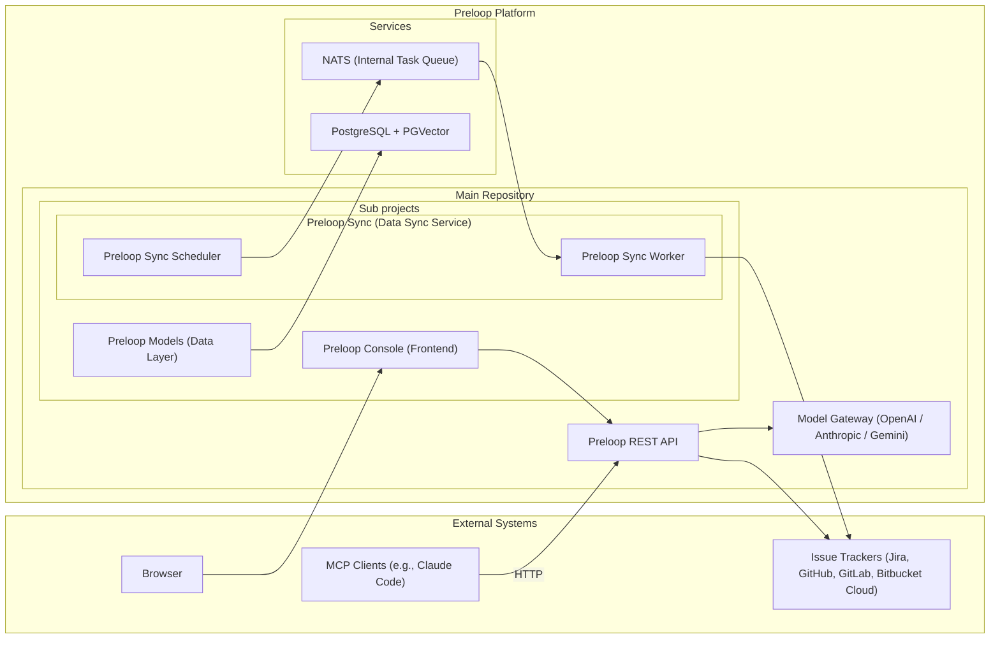

# Preloop Architecture

Preloop is an open-source, responsible AI automation platform. It can proxy tools from MCP servers, optionally adding a human approval layer with configurable policies. It provides event-driven agentic flows to intelligently automate common tasks using the agent harnesses registered in `preloop.agents.factory`: OpenHands, Aider, Codex CLI, Gemini CLI, OpenCode, Pi and DeepSeek Harness. It integrates with issue & code tracking systems like Jira, GitHub, GitLab, Bitbucket Cloud, both for listening to events and for ingesting issues, comments, documentation and code. By leveraging vector-based similarity search, Preloop detects duplicate and overlapping issues, detects unmapped dependencies, evaluates compliance metrics, and offers intelligent suggestions to streamline workflows. The architecture now also includes Preloop-owned model-gateway surfaces so managed runtimes can route model traffic through a central enforcement point for telemetry, budgets, session observability, and secret custody. The architecture emphasizes flexibility, performance, and ease of integration, providing access via a REST API, a web UI, and an MCP server for various clients.

ARCHITECTURE.md is the map. Read one chapter under `docs/architecture/` for the subsystem you are changing. Do not load every chapter for context.

## High-Level Architecture

## Chapters

| Chapter | What it covers |
|---|---|
| [Overview](docs/architecture/overview.md) | High-level layout, key components, and the REST search path. Start here for how the API, console, sync, and gateway fit together. |
| [Frontend](docs/architecture/frontend.md) | Console structure (Lit, Vite, TypeScript, Shoelace). Tracker detail, tools page, and cost views. |
| [Model gateway](docs/architecture/gateway.md) | OpenAI-, Anthropic- and Gemini-compatible ingress (`/openai/v1`, `/anthropic/v1`, `/gemini/v1beta`), accounting, budgets, and runtime session identity. |
| [Governance](docs/architecture/governance.md) | Subject-scoped allowed models, tool access rules, and tool output filters. |
| [Account access rules](docs/architecture/account-access-rules.md) | Closed policy syntax, audited CRUD/snapshots, committed H4 invalidation, and H3 resource sharing integration. Includes the portable exact-resource selector and resource requirement contract. Core owns atomic storage, reference validation and generation invalidation; Enterprise owns preview authorization and enforcement of independent local gates. |
| [Approvals](docs/architecture/approvals.md) | Tool configuration, human-in-the-loop approval workflows, `ask_user`, and native-tool permission-check. |
| [Agent Control](docs/architecture/agent-control.md) | Operator channel to managed agents, operator notes delivered at model/tool boundaries through the gateway, carrying permission hooks, or native lifecycle/model-input hooks; non-carrying approval hooks leave notes pending, CLI/desktop enrollment, mobile/watch voice contact, and persistent flow execution on a live Agent Control target. |
| [Cost](docs/architecture/cost.md) | `ApiUsage` ledger, OSS spend and budget-health surfaces, and the Enterprise plugin boundary. |
| [Sync](docs/architecture/sync.md) | Tracker polling, NATS scheduler/worker, issue tracker clients, and tracker scope rules. |
| [Data model](docs/architecture/data-model.md) | `preloop.models`, PostgreSQL + PGVector, schema, and backend project layout. |
| [MCP](docs/architecture/mcp.md) | FastMCP integration, dynamic tool filtering, and the HTTP MCP request path. |
| [MCP protocol compatibility](docs/architecture/mcp-protocol-compatibility.md) | SDK 2 / FastMCP 4 APIs, modern and legacy transport matrix, validation and no-replay boundary. |
| [Realtime](docs/architecture/realtime.md) | Unified WebSocket, account-scoped pub/sub, execution snapshots and durable sequence cursors, and bounded flow lifecycle startup. |
| [Security](docs/architecture/security.md) | Auth and tenancy, generation-based session revocation and live WebSocket teardown across replicas, account-scoped member sign-out, separate machine credentials, restricted CI identities, owned review execution admission, principal-bound callbacks, redaction, secret custody, audit integrity and `preloop.security`. |
| [Decisions](docs/architecture/decisions.md) | Why FastAPI, Python, and PostgreSQL, and how the stack is deployed (Compose, Helm, service roles). |
| [Flows](docs/architecture/flows.md) | Event-driven agentic flows, remote runners, matrix/batch fan-out, delegation and execution trees, label-based model routing, eval artifacts, durable review completion evidence, evidence packs, prompt `truncate(N)`, and the chunked agent launch-payload environment. |
| [Callback receipts](docs/architecture/callback-receipts.md) | `complete_once` receipts for signed provider callbacks, without storing request content. |
| [MCP dispatch provenance](docs/architecture/mcp-dispatch-provenance.md) | The identity-only extension event for completed proxied calls. Optional plugins own inventory interpretation; hook labels and mutable tool-name maps cannot establish server identity. |
| [Upstream MCP OAuth](docs/architecture/upstream-mcp-oauth.md) | OAuth for external MCP servers Preloop connects to, separate from the inbound MCP authorization server. |
| [Managed tracker OAuth storage](docs/architecture/managed-oauth-storage.md) | Provider-neutral storage contract for managed tracker OAuth credentials. |
| [Runners and remote sessions](docs/architecture/runners.md) | Private runner capabilities, owner consent, native host-profile publication and continuation, remote harness sessions and workspace policy. |
| [Runner-proxied local models](docs/architecture/runner-local-models.md) | Local models proxied through a private runner (#1833). |
| [Identity, membership and SSO](docs/architecture/identity.md) | Canonical person identities, users, teams, edition overlays, enterprise sign-on persistence, session assurance and offboarding. |
| [Chat connections](docs/architecture/chat.md) | Chat provider setup and authenticated chat operations. |
| [Discovery source observations](docs/architecture/discovery.md) | Versioned discovery evidence: storage, correlation boundary and presentation. |
| [Telemetry and activity](docs/architecture/telemetry.md) | OpenTelemetry export and ingest, activity and analytics primitives, vendor activity imports, recording timeline sync. |
| [Similar sessions](docs/architecture/similar-sessions.md) | Finding sessions similar to the one being viewed. |
| [Platform operations](docs/architecture/operations.md) | Release publication gate, database connection pools, upgrade acceptance and API diagnostics. |
