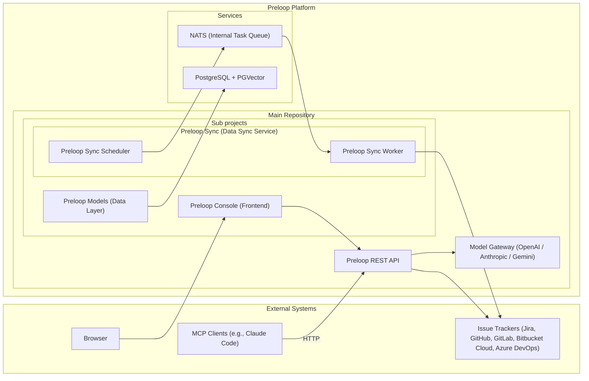

# Preloop Architecture

Preloop is an open-source, responsible AI automation platform. It can proxy tools from MCP servers, optionally adding a human approval layer with configurable policies. It provides event-driven agentic flows to intelligently automate common tasks using the agent harnesses registered in `preloop.agents.factory`: OpenHands, Aider, Codex CLI, Gemini CLI, OpenCode, Pi and DeepSeek Harness. It integrates with issue & code tracking systems like Jira, GitHub, GitLab, Bitbucket Cloud, both for listening to events and for ingesting issues, comments, documentation and code. By leveraging vector-based similarity search, Preloop detects duplicate and overlapping issues, detects unmapped dependencies, evaluates compliance metrics, and offers intelligent suggestions to streamline workflows. The architecture now also includes Preloop-owned model-gateway surfaces so managed runtimes can route model traffic through a central enforcement point for telemetry, budgets, session observability, and secret custody. The architecture emphasizes flexibility, performance, and ease of integration, providing access via a REST API, a web UI, and an MCP server for various clients.

ARCHITECTURE.md is the map. Read one chapter under `docs/architecture/` for the subsystem you are changing. Do not load every chapter for context.

Execution credential fingerprints are shared by output persistence and the model
gateway. Container and runner capture mask the same issued values before delivery;
see [agent isolation](docs/security/agent-isolation.md) for credential visibility
and lifetime limits.

Policy variable references are resolved by the CLI from the operator's local
environment before upload. API validation, application, and version restore
preserve submitted values; the shared policy applier does no environment
substitution. See [Policy-as-code](docs/guide/concepts/policy-as-code.md).

Refused CI triggers and agent permission checks use durable minute counters;
closed counters join the existing audit hash chain. Session-end lifecycle writes
are idempotent. See [refusal counters and chain sealing](docs/architecture/security.md#refusal-counters-and-chain-sealing).

## High-Level Architecture

## Chapters

| Chapter | What it covers |
|---|---|
| [Overview](docs/architecture/overview.md) | High-level layout, key components, and the REST search path. Start here for how the API, console, sync, and gateway fit together. |
| [Frontend](docs/architecture/frontend.md) | Console structure (Lit, Vite, TypeScript, Shoelace). Tracker detail, tools page, and cost views. |
| [Model gateway](docs/architecture/gateway.md) | OpenAI-, Anthropic- and Gemini-compatible ingress (`/openai/v1`, `/anthropic/v1`, `/gemini/v1beta`), accounting, budgets, terminal provider refusals, and runtime session identity. |
| [Governance](docs/architecture/governance.md) | Subject-scoped allowed models, tool access rules, and tool output filters. |
| [Account access rules](docs/architecture/account-access-rules.md) | Closed policy syntax, audited CRUD/snapshots, committed H4 invalidation, and H3 resource sharing integration. Includes the portable exact-resource selector and resource requirement contract. Core owns atomic storage, reference validation and generation invalidation; Enterprise owns preview authorization and enforcement of independent local gates. |
| [Approvals](docs/architecture/approvals.md) | Tool configuration, human-in-the-loop approval workflows, [external consent hand-off](docs/guide/webhooks.md#external-approval-hand-off), `ask_user`, and native-tool permission-check. |
| [Claude Code enrollment](docs/guide/clients/claude-code.md) | Gateway disclosures, server-observed route state, approval waits, owned artifacts and audited credential revocation. |
| [Managed bundles](docs/architecture/managed-bundles.md) | Account-scoped bundle revisions, verified Claude Code extension overlays and durable control expectations for optional evidence-based fleet generation. |
| [Agent Control](docs/architecture/agent-control.md) | Native Talk session identity and resume routing, immutable launch directories, operator notes delivered at model/tool boundaries through the gateway, carrying permission hooks, or native lifecycle/model-input hooks; non-carrying approval hooks leave notes pending, CLI/desktop enrollment, mobile/watch voice contact, persistent flow execution, and opt-in herdr terminal location and state observations. |
| [Cost](docs/architecture/cost.md) | `ApiUsage` ledger, OSS spend and budget-health surfaces, and the Enterprise plugin boundary. |
| [API traffic and account health](docs/operations/api-traffic-and-account-health.md) | Per-minute REST traffic rollups and individual 4xx/5xx events for every credential kind, the operator account health read, and run-scoped key maintenance. |
| [Plugin health](docs/plugin-health.md) | Eager plugin discovery, fatal extension failures, authenticated fleet status and durable job completion evidence. |
| [Sync](docs/architecture/sync.md) | Tracker polling, NATS scheduler/worker, issue tracker clients, and tracker scope rules. |
| [Data model](docs/architecture/data-model.md) | `preloop.models`, PostgreSQL + PGVector, schema, and backend project layout. |
| [MCP](docs/architecture/mcp.md) | FastMCP integration, dynamic tool filtering, and the HTTP MCP request path. |
| [MCP protocol compatibility](docs/architecture/mcp-protocol-compatibility.md) | SDK 2 / FastMCP 4 APIs, modern and legacy transport matrix, validation and no-replay boundary. |
| [Realtime](docs/architecture/realtime.md) | Unified WebSocket, account-scoped pub/sub, execution snapshots and durable sequence cursors, and bounded flow lifecycle startup. |
| [Security](docs/architecture/security.md) | Auth and tenancy, optional account sign-in strength hooks and enrollment-only sessions, generation-based session revocation and live WebSocket teardown across replicas, account-scoped member sign-out, separate machine credentials, restricted CI identities, owned review execution admission, principal-bound callbacks, redaction, secret custody, audit integrity and `preloop.security`. |
| [Decisions](docs/architecture/decisions.md) | Why FastAPI, Python, and PostgreSQL, and how the stack is deployed (Compose, Helm, service roles). |
| [Flows](docs/architecture/flows.md) | Event-driven agentic flows, explicit Azure review requests, interactive hosted conversations, remote runners, matrix/batch fan-out, delegation and execution trees, label-based model routing, eval artifacts, bound review context and command inspection, authoritative terminal events, durable review completion evidence, named failure outcomes, evidence packs, prompt `truncate(N)`, the chunked agent launch-payload environment, and mounted Delivery Report setup files. |
| [Callback receipts](docs/architecture/callback-receipts.md) | `complete_once` receipts for signed provider callbacks, without storing request content. |
| [Review and status posted by Preloop](docs/architecture/platform-posted-review.md) | The control plane posts a validated read-only review and a commit status with a one-repository lease, admits fork event reviews only with a GitHub-verified maintainer label, attempts deferred reviews at the evidence settle deadline, and recovers lost timers through the monitor sweep. Human-authorized stored-answer re-finalization, preview/apply digests, audit, publication gates, threat model and tests. |
| [Shared review flows for restricted CI](docs/architecture/shared-ci-review-flows.md) | One read-only review flow serving several projects with one project per CI identity: the allowlist, how an execution's project is resolved, the threat model with its tests, and what is not included. |
| [MCP dispatch provenance](docs/architecture/mcp-dispatch-provenance.md) | The identity-only extension event for completed proxied calls. Optional plugins own inventory interpretation; hook labels and mutable tool-name maps cannot establish server identity. |
| [Upstream MCP OAuth](docs/architecture/upstream-mcp-oauth.md) | OAuth for external MCP servers Preloop connects to, separate from the inbound MCP authorization server. |
| [Subscription credential recovery](docs/guide/clients/subscription-recovery.md) | Shared OAuth lineage repair, healthy-secret preservation, onboarding validation, and local-store recovery before offboarding. |
| [Managed tracker OAuth storage](docs/architecture/managed-oauth-storage.md) | Provider-neutral storage contract for managed tracker OAuth credentials. |
| [Runners and remote sessions](docs/architecture/runners.md) | Private runner capabilities, owner consent, native host-profile publication and continuation, remote harness sessions and workspace policy. |
| [Runner-proxied local models](docs/architecture/runner-local-models.md) | Local models proxied through a private runner (#1833). |
| [Identity, membership and SSO](docs/architecture/identity.md) | Canonical person identities, users, teams, edition overlays, enterprise sign-on persistence, session assurance and offboarding. |
| [Chat connections](docs/architecture/chat.md) | Chat provider setup (including single-tenant Teams REST transport), authenticated operations, durable chat-triggered flow replies, and bindings to shared interactive conversations. |
| [Discovery source observations](docs/architecture/discovery.md) | Versioned discovery evidence: storage, correlation boundary and presentation. |
| [Telemetry and activity](docs/architecture/telemetry.md) | OpenTelemetry export and ingest, activity and analytics primitives, vendor activity imports, recording timeline sync. |
| [Similar sessions](docs/architecture/similar-sessions.md) | Finding sessions similar to the one being viewed. |
| [Session search and navigation](docs/operations/session-search.md) | Identity and content search, scoped turn-page cursors, and deep links into captured activity. |
| [Platform operations](docs/architecture/operations.md) | Release publication gate, database connection pools, upgrade acceptance, API diagnostics and shared request rate limiting. |

User authentication includes optional TOTP and hashed recovery codes, with
single-use challenges and fresh-authentication checks for factor management.
See [security architecture](docs/architecture/security.md) and the
[operator guide](docs/operations/mfa.md). Account policy enforcement is an
edition extension.

Installed agent extension inventory uses a bounded, metadata-only v3 discovery
contract. `discovered_extension` stores presence per account, device, profile and
agent; `extension_approval` stores account-wide decisions independently of
inventory retention, and `extension_approval_pin` pins a decision to reviewed
content hashes. CRUD owns reconciliation, approval joins and the single
`effective_state` derivation (`content_changed` when a pinned approval meets an
unpinned hash). Only complete
app scans prove absence; older reports cannot replace newer inventory. Extension
files, commands and source URLs remain on the device. See the
[discovery reporting guide](docs/guide/agent-discovery-reporting.md#extensions).
Unmatched MCP tool calls read account policy defaults. With approve-once enabled,
the account-owned `tool_registry_entry` records a decision per proxy server UUID
or direct-hook server label and exposed tool name. CRUD serializes first sightings
and approval attachment in one transaction; approval resolution updates the route
decision, and async replays recheck the current policy before dispatch. Native
agent tools retain their client-decision fallback. See
[policy defaults](docs/guide/concepts/policy-as-code.md#unlisted-tools).

**Request rate limiting.** `backend/preloop/services/rate_limit.py` enforces
fixed-window budgets for auth, OAuth, public approvals, passkey challenges,
verification and password-reset email, OTLP ingest, and test pushes. PostgreSQL
counters updated through CRUD share budgets across replicas and survive restarts;
a store outage logs an error and falls back to per-process enforcement. Refusals
return 429 with `Retry-After` and increment `preloop_rate_limit_hits_total{rule}`.
JSON APIs carry `rate_limited`; OTLP retains its protocol envelope. Operator notes
and desktop views separately count persisted rows over a rolling hour. See the
[architecture chapter](docs/architecture/operations.md#request-rate-limiting),
[rules and audit behavior](docs/operations/rate-limiting.md), and the supported
[Helm extraEnv configuration](helm/preloop/README.md#request-rate-limiting), which
keeps backend defaults authoritative across deployment methods.

OpenRouter model configurations can enforce provider routing preferences. Gateway
usage records include a content-free summary of effective upstream controls and
the OpenRouter serving host when reported; see the
[provider guide](docs/guide/providers/openrouter.md).
