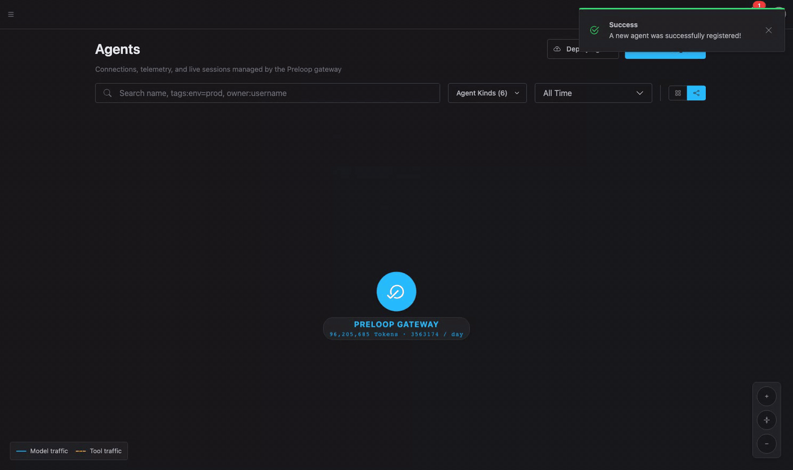
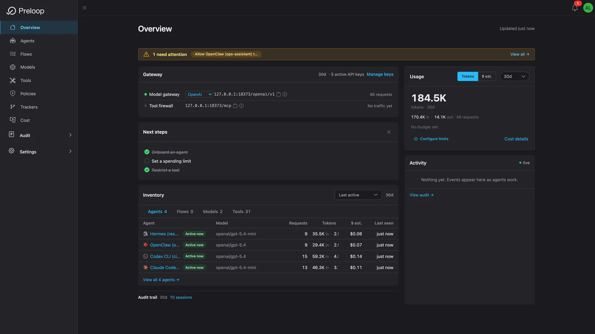

#  Preloop

[](https://github.com/preloop/preloop/actions/workflows/ci.yml)
[](https://github.com/preloop/preloop/releases/latest)
[](https://pypi.org/project/preloop/)
[](https://www.python.org/downloads/)
[](LICENSE)
[](https://www.bestpractices.dev/projects/15223)
[](https://scorecard.dev/viewer/?uri=github.com/preloop/preloop)

**The open-source AI agent control plane and software factory.**

Preloop is one self-hostable service that sits between your AI agents and everything they reach, and runs agents for you when work arrives. Every tool call and every model call is governed, attributed and visible, whether a person started the agent or a ticket did. You see spend by model, agent, session, API key and flow, including imported Copilot usage, and cap it with budgets.

It has two halves, and the same policies, budgets and session timeline apply to both:

- **Control plane.** An MCP firewall that allows, denies or holds any tool call for human approval; an AI model gateway with budgets and attribution; policy-as-code in YAML and CEL; one runtime timeline per session.
- **Software factory.** Flows run agents, in hosted containers or on your own runners, when GitHub, GitLab, Bitbucket Cloud, Jira, a webhook or a CI job fires. Presets review pull requests, implement issues, triage tickets, scan for vulnerabilities and collect evidence packs. A human can steer a running agent from the console, phone or watch, and the work lands as pull requests you can review.

**Who it is for:**

- Platform and security teams that need agents governed before they reach production systems.
- Engineering teams running coding agents that want to see the cost and keep an audit trail.
- Teams that want tickets and events turned into bounded agent work they can review.

Works with OpenClaw, Claude Code, Codex CLI, Cursor, Gemini CLI, Hermes, OpenCode, Devin, Copilot CLI, and any MCP-compatible agent.

## Your first five minutes

```bash
# 1. Install the CLI (macOS / Linux / WSL)
curl -fsSL https://preloop.ai/install/cli | sh

# Windows, native (PowerShell): irm https://preloop.ai/install/cli.ps1 | iex
# Details: docs/windows-cli.md

# 2. Connect it to a control plane
preloop signup                                # Preloop Cloud (fastest), or
preloop login --url http://localhost:3000    # your self-hosted instance

# 3. Bring local agents under governance
preloop agents discover
```

`preloop agents discover` finds local agent configs and reports what each adapter supports. `preloop agents onboard` configures them: calls routed through the managed MCP entry reach the **MCP Firewall**, supported model routes use the **Gateway**. To talk to a running agent, install the runtime plugin with `preloop agents install-plugin` (or `preloop claude` for Claude Code). Full walkthrough: [onboard local agents](https://docs.preloop.ai/quickstart-cli/).

<p align="center">
  
</p>

## Watch it work

Onboarding, the MCP firewall, human approvals, and cutting session cost. Recorded against a real stack, no slideware.

<p align="center">
  <a href="https://www.youtube.com/watch?v=Y_geb2Or8zM&list=PLr2Jp0c-Qn2hoYL3aRZGUtBjTCVygWIXt">
    
  </a>
</p>

<p align="center"><a href="https://www.youtube.com/watch?v=Y_geb2Or8zM&list=PLr2Jp0c-Qn2hoYL3aRZGUtBjTCVygWIXt"><b>Watch the full playlist &rarr;</b></a></p>

## What you get

Jobs teams otherwise buy from several vendors, in one Apache 2.0 stack:

| Capability | What it does | Alternatives |
|---|---|---|
| **MCP Firewall** | Govern every tool call. Allow, deny, require approval, require justification. YAML + CEL. | MintMCP, Lunar.dev MCPX, TrueFoundry |
| **AI Model Gateway** | OpenAI-, Anthropic- and Gemini-compatible. Budgets, allowed-model lists, token accounting, attribution. | Portkey, Helicone, LiteLLM, Kong AI |
| **Flows** | Start an agent when a tracker, webhook, or CI job fires, with the same firewall, approvals, and cost. `preloop flow trigger`. | Custom CI glue, AgentCore Runtime |
| **Private runners** | Run flow agents on your own machines over an outbound WebSocket, no inbound ports. | Self-managed CI runners |
| **Agent Control** | Talk to long-running agents from the console, phone, or watch. Steer runs with [operator notes](docs/guide/operator-notes.md). | Terminal access |
| **Cost & Budgets** | Spend by model, agent, session, API key, flow, and user, including [imported Copilot usage](docs/guide/copilot-usage-import.md). | FinOps dashboards, vendor billing exports |
| **Human Approvals** | Mobile, watch, Slack, Mattermost, email, webhook, or `preloop approvals`. Native `Bash`/`Edit`. Agents can `ask_user`. | Custom Slack bots, Peta Desk |
| **Runtime Observability** | One session timeline: tool calls, model calls, policy, approvals, spend, outcomes. | AgentOps, Langfuse, LangSmith |
| **Fleet Map** | People, devices, agents, models and observed work in one [map](docs/guide/fleet-map.md). | Spreadsheets |
| **Evidence packs** | Apache flow presets write `result.json` plus an evidence directory for CRA / AI Act-style work. Not a certification. | Custom GRC folders |

```text
AI Agent → Preloop → [Policy]  → Allow / Deny / Require Approval → Execute
                   → [Gateway] → Budget + attribution             → Model
```

## The software factory

One loop, end to end: an issue event arrives from GitHub, GitLab, Bitbucket Cloud or Jira. A flow starts an agent in a hosted container or on your own runner. Every tool call it makes passes the same firewall and approvals as your own agents, and every model call is charged to the flow's budget. The agent opens a pull request; the [Pull Request Reviewer](docs/guide/flows/pull-request-review.md) reviews it; review or CI feedback resumes [the implementation](docs/guide/flows/durable-implementation-feedback.md) on the same branch, and the result is a pull request you can review. You can steer the run with an operator note at any point, and the whole run is one timeline.

[20 presets](backend/presets/README.md) ship in this repository, including:

- [Issue Triage Assistant](docs/guide/flows/issue-triage.md) and issue refinement
- [Pull Request Reviewer](docs/guide/flows/pull-request-review.md)
- [Automated issue implementation](docs/guide/flows/automated-issue-implementation.md)
- [Security audit presets](docs/guide/flows/security-audit-presets.md): SBOM verify, exploit check, release audit. They collect machine evidence for CRA- and EU AI Act-style reviews. That is not a conformity assessment, certification, or legal advice.
- [Observe / Eval](./backend/presets/003-observe-eval.yaml)
- Component due diligence, architecture and strategy review, repo code health review
- Standards compliance walk, release backport, weekly model price review

Or write your own. Trigger from CI with the [`run-flow` GitHub Action](docs/guide/flows/github-actions.md); run agents on [private runners](docs/guide/runners/quickstart-linux.md); let a flow start child flows with [flow delegation](docs/guide/flows/flow-delegation.md). Tracker setup: [Bitbucket and Jira quickstart](docs/guide/bitbucket-jira-quickstart.md); [Bitbucket Data Center](docs/guide/bitbucket-data-center.md) is available as an opt-in provider.

## Policy-as-code

```yaml
version: "1.0"
metadata:
  name: "Production Safeguards"

approval_workflows:
  - name: "deploy-approval"
    timeout_seconds: 600
    required_approvals: 1
    async_approval: true

tools:
  - name: "bash"
    source: mcp
    approval_workflow: "deploy-approval"
    justification: required
    conditions:
      - expression: "args.command.contains('deploy') && args.command.contains('production')"
        action: require_approval
```

Check a sample call before saving with **Test this rule** or **Simulate** in the console. Ship it with `preloop policy apply <file>` (`validate` / `diff` / `export` also exist).

<p align="center">
  <a href="frontend/public/assets/screenshots/quickstart/dark/dashboard.png"></a>
</p>

## More capabilities

- **Model providers:** OpenAI, Anthropic, Google, [Amazon Bedrock](docs/guide/providers/bedrock.md), [Azure OpenAI](docs/guide/providers/azure-openai.md), [Alibaba Cloud Model Studio](docs/guide/alibaba-model-studio.md), DeepSeek, Mistral, Moonshot, Z.ai, OpenRouter, any OpenAI-compatible endpoint, and [runner-proxied local models](docs/guide/runner-local-models.md). [Reviewed model pricing](docs/guide/model-price-refresh.md); unpriced models stay visibly unpriced.
- **Restricted CI identity:** a machine identity bound to one project and one flow for CI jobs. [Guide](docs/guide/flows/restricted-ci.md).
- **Account kill switch:** blocks gateway and tool traffic and stops managed flow runs, with audited recovery. [Guide](docs/guide/account-kill-switch.md).
- **Session search:** keyword search by default, semantic as an opt-in, every search audited. [Saved searches](docs/guide/session-saved-searches.md).
- **DORA exports:** the AI-agent slice of the ICT inventory and incident record. [Guide](docs/guide/dora-agent-slice.md).
- **OTLP export:** off by default; emits OpenTelemetry GenAI spans. [Guide](docs/guide/observability-otlp.md).
- **Chat:** Slack, Mattermost, and Discord for questions, approval votes and operator notes. [Chat connections](docs/chat-connections.md).
- **Event-driven employees:** managed agents doing bounded tasks from tracker and error events. [Guide](docs/guide/virtual-employees.md).
- **Remote sessions and deployment:** [remote sessions](docs/guide/runners/remote-sessions.md), [SSH and GCP agent deployment](docs/operations/agent-deployment.md), [environments and recovery](docs/guide/flows/environments-and-recovery.md).
- **Runtime plugins:** [Pi and DeepSeek Harness](runtime-plugins/harness-preloop/README.md), [Nanobot](runtime-plugins/nanobot-preloop/README.md), [OpenClaw](https://docs.preloop.ai/integrations/openclaw/), [Hermes](docs/guide/hermes.md), [runtime adapters](https://docs.preloop.ai/integrations/agent-control-runtime-adapters/).

Everything else: [docs.preloop.ai](https://docs.preloop.ai).

## Getting started

The CLI is a client. It talks to a control plane: [Preloop Cloud](https://preloop.ai) or a stack you run.

**Cloud (fastest)**

```bash
curl -fsSL https://preloop.ai/install/cli | sh
preloop signup
preloop agents discover
```

**Self-host (Docker Compose, data stays on your machine)**

```bash
curl -fsSL https://preloop.ai/install/oss | sh
curl -fsSL https://preloop.ai/install/cli | sh
preloop login --url http://localhost:3000
preloop agents discover
```

Console: `http://localhost:3000`. CLI login commands: [CLI authentication](cli/README.md#authentication). TLS, SMTP, upgrades and Kubernetes: [Install the OSS stack](https://docs.preloop.ai/self-hosting/installation/), Helm chart [`helm/preloop`](helm/preloop), [compatibility policy](docs/compatibility.md). Docker Compose and Helm are the supported install surfaces; this repository does not ship Terraform modules.

Credential storage upgrades require a maintenance window and the existing encryption key; follow the [staged upgrade guide](docs/operations/credential-storage-upgrade.md) before upgrading an existing installation.

Production self-host: `SECRET_KEY` is required or the app refuses to start, and the Helm chart refuses to install while `environment.jwtSecret` is empty or a placeholder (see [helm/preloop/README.md](helm/preloop/README.md#jwt-authentication)). The development `docker-compose.yml` ships development-only credential defaults; override them with a `.env` file (start from `.env.example`). Telemetry is a daily pseudonymous version check-in; set `PRELOOP_DISABLE_TELEMETRY=true` to disable. Event list: [SECURITY.md](SECURITY.md#telemetry).

## Open-source alternative to AWS Bedrock AgentCore

Same core jobs (runtime, gateway, identity, observability, policy), vendor-neutral and self-hostable. Full comparison: [preloop.ai/vs/aws-agentcore](https://preloop.ai/vs/aws-agentcore).

| | Preloop | AWS Bedrock AgentCore |
|---|:---:|:---:|
| Open source (Apache 2.0) | Yes | No |
| Self-hostable (VPC / on-prem) | Yes | No |
| Policy-as-code (YAML + CEL) | Yes | Limited |
| MCP-native tool governance | Yes | Partial |
| Human approvals (mobile, Slack, webhook) | Yes | Limited |
| Onboard existing local agents (`preloop agents discover`) | Yes | No |

Also compare: [LiteLLM](https://preloop.ai/vs/litellm), [Portkey](https://preloop.ai/vs/portkey), [Helicone](https://preloop.ai/vs/helicone), [MintMCP](https://preloop.ai/vs/mintmcp), [Lunar](https://preloop.ai/vs/lunar), [Runlayer](https://preloop.ai/vs/runlayer), [Zenity](https://preloop.ai/vs/zenity).

## Editions

Unqualified **Preloop** is this repository (Apache 2.0, self-hosted). **Preloop Cloud** is the hosted service at [preloop.ai](https://preloop.ai). **Preloop Enterprise** is the commercial self-hosted edition. Cloud and Enterprise include support plans. Cloud billing owners can compare usage from the previous three completed months in Account settings before requesting a plan-change quote.

Your data: self-hosted, nothing leaves your network except the optional daily version check. On Preloop Cloud, sessions are stored only to give you search, audit trails, cost reports and policy enforcement; they are not used to train models and are not sold or shared. Details: [Security & Privacy](docs/security/security-privacy.md#your-data).

Governance itself is open source: every model provider, flows, private runners, session search, operator notes, the audit trail, single-approver workflows and budgets scoped to the account, a flow, an API key or a managed agent. What is commercial is the organizational layer on top:

| Feature | Open Source | Cloud / Enterprise |
|---|:---:|:---:|
| Audit collection, query API, and console | Yes | Yes |
| Users, teams, and RBAC on one account | No | Yes |
| Budgets scoped to a user or a team, budget notification routing | No | Yes |
| Multi-approver routing, quorum, escalations | No | Yes |

A self-hosted OSS instance is one operator per account. Public signup, if left on, creates a separate account, not a teammate. Enterprise licensing: sales@preloop.ai.

## Working in this repository

| If you need | Read |
|---|---|
| How the system fits together | [ARCHITECTURE.md](ARCHITECTURE.md), then one chapter under [`docs/architecture/`](docs/architecture/) |
| Commands, DB/CRUD rules, Lit frontend | [AGENTS.md](AGENTS.md) |
| PR process | [CONTRIBUTING.md](CONTRIBUTING.md) |
| Operator and client guides | [docs.preloop.ai](https://docs.preloop.ai) |
| Policy examples | [`backend/presets/`](./backend/presets/) |

## Community

[Discord](https://discord.gg/P6nWSee4jv) for help, feedback, and the founder's build log.

## Contributing

See [CONTRIBUTING.md](CONTRIBUTING.md). Maintainers: follow the [protected-branch release process](./docs/releasing.md).

## License

[Apache License 2.0](LICENSE). Copyright (c) 2026 Spacecode AI Inc.

Release assets carry signed Sigstore build provenance and checksums ([verification](./docs/release-verification.md)). Windows CLI notes: [windows-cli.md](./docs/windows-cli.md), [code signing policy](./docs/code-signing-policy.md). Free code signing provided by [SignPath.io](https://about.signpath.io/), certificate by [SignPath Foundation](https://signpath.org/).
