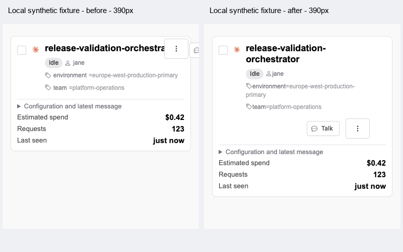
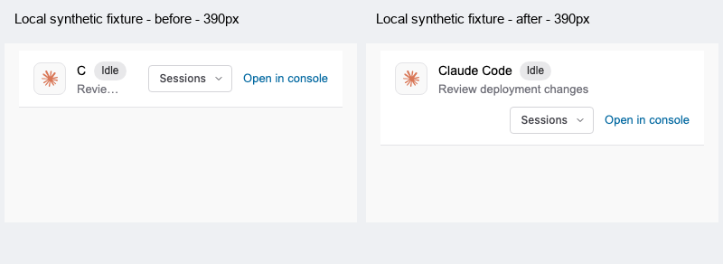

# Responsive agent identity

These comparisons show local synthetic fixtures at a 390 × 844 viewport,
with a 16px page inset and the real component renderers and styles. Left:
source at `6d4b6fe3`. Right: this change.
They contain no production records. Empty lower viewport space is cropped;
component pixels are unchanged.

The card uses a long generic agent name and environment tag. Talk uses
“Claude Code” and the session title “Review deployment changes”. Both use
system Arial and locally served Shoelace icons. These are component screenshots, not full
application or deployed screenshots.

The adjacent view test suites cover real mounted components, long unbroken
names, owners, tags and session titles, geometry at 320/360/390/640/1440px,
keyboard tab order, and the existing Talk session-switching behavior.
